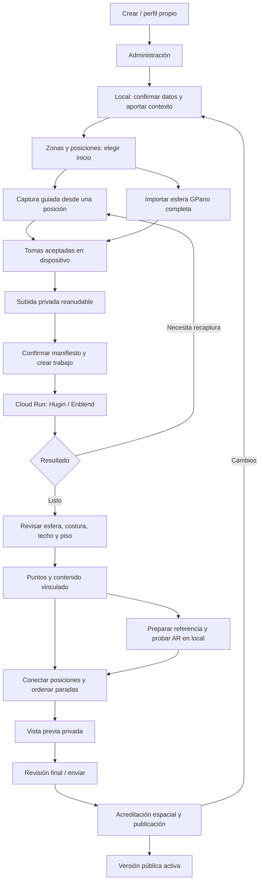
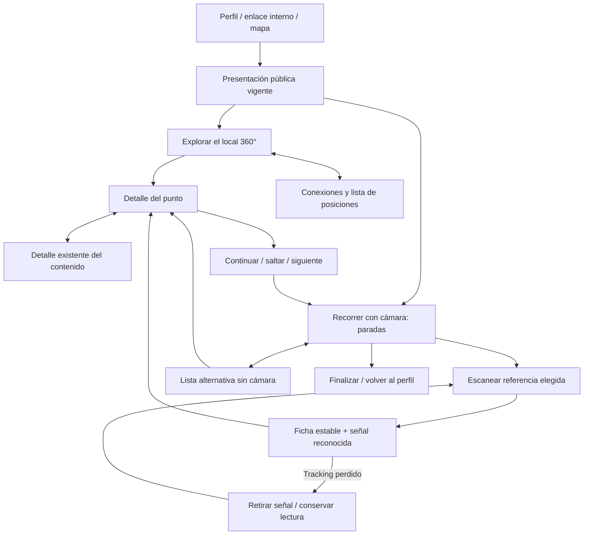

# MAREA · Recorridos 360° del local y experiencias AR

6 de octubre de 2026. **Diseño actualizado e implementación en el checkout; pendiente de validación óptica, AR físico y piloto de infraestructura.** Las láminas son referencias de diseño, no evidencia de pruebas ni aprobación del producto. El prototipo HTML anterior no existe en este repositorio; no se enlaza.

## Experiencias y alcance

Un negocio muestra su local desde casa y ofrece información al visitarlo físicamente. Son dos entradas al mismo recorrido:

| Entrada | Comportamiento | Permisos |
|---|---|---|
| **Explorar el local · 360°** | Mirar alrededor por arrastre en panoramas completos **360° × 180°**, cambiar de posición mediante conexiones y consultar puntos. | No solicita cámara ni ubicación. Sensores de visualización opcionales en móvil. |
| **Recorrer con cámara** | Elegir una parada, reconocer su imagen física, mostrar una señal espacial discreta y una ficha estable. | Cámara cuando se elige escanear. Sin compatibilidad o permiso, usar lista y panoramas. |

Cada panorama corresponde a **una posición fija**, no a todo el local. Para crearlo se toman varias fotos girando el teléfono alrededor de su lente, manteniendo su posición, con techo y piso. Después se mueve a otra posición y repite. Las conexiones entre posiciones forman la visita; no hay reconstrucción navegable en 3D ni flechas precisas de navegación por el suelo.

El ejemplo ficticio consistente es **Café Marea**, Roma Norte, CDMX: Entrada (Puerta, Vestíbulo), Barra (Frente a barra), Mural (Frente al mural), Terraza (Centro de terraza). No se carga este ejemplo como contenido de producción.

## Base existente e integración

| Base existente | Incorporación del módulo |
|---|---|
| Sesión, perfiles y capacidades profesionales | Repositorios de recorridos, captura local y procesamiento integrados en `AppSessionController`. Crear desde perfil profesional; ser Negocio no acredita un local. |
| Ubicación, horarios y contacto | Recuperar del perfil; confirmar o completar. Usar el selector de ubicación existente. |
| Obras, productos, servicios, publicaciones y misiones | Referencias hacia los detalles actuales, sin duplicar su contenido ni permisos. **Negocios conservan Servicios; Productos corresponde a emprendimientos.** |
| Crear y herramientas del perfil propio | Entrada a administración de recorridos y solicitudes. |
| Perfil público | Tarjeta «Explorar el local · 360°» para versiones disponibles. |
| Moderación | Entrada a «Espacios y recorridos», con acreditación y revisión de la versión enviada. |
| Mapa de misiones | Consulta adicional de recorridos vigentes y capa separada; mantiene consultas y filtros de misiones. |
| Enlaces internos | `/tours/:id`, `/tours/:id?point=:point`, `/tours/:id/ar?point=:point`. El destino se conserva tras autenticación. Compartir esos enlaces permite generar un QR externo; un QR abre contenido y **no posiciona AR**. |

Módulo: `lib/features/tours/`. Contratos y secuencia de implementación: [plan técnico](implementation/tours-360-plan.md). Integraciones: [canales nativos](implementation/tours-native.md). Operación: [procesador y despliegue](../processing/tours/README.md).

## Estructura compartida

**Espacio → zonas → posiciones 360° → puntos → contenido vinculado.** Un recorrido/versionado contiene conexiones, inicio, orden de paradas y vigencia.

| Entidad | Información y reglas |
|---|---|
| Espacio | Nombre, ubicación pública, contexto y evidencia privada de responsabilidad; permiso del responsable independiente del autor de contenido. Primera acreditación manual/admin. |
| Recorrido y versión | Título, inicio, conexiones, paradas, vigencia; versión pública activa, borrador editable y snapshot enviado separados. |
| Zona | Nombre, descripción y varias posiciones. Las cuatro zonas del ejemplo son sugerencias. |
| Posición 360° | Panorama completo, variantes/miniatura, orientación inicial, puntos y conexiones. Cada conexión tiene destino, nombre e indicación escrita. |
| Punto | Nombre y explicación; ángulos yaw/pitch opcionales. «Solo en lista» es válido. Colocarlo en el panorama no crea un anclaje físico. |
| Activador AR | Imagen reconocible o distintivo único imprimible; ancho físico obligatorio, versión de referencia y prueba de reconocimiento. Cambiar referencia/ancho invalida la prueba. |
| Captura | Archivos aceptados, orientación relativa, dimensiones reales, FOV disponible y manifiesto; revisión enviada inmutable. |
| Trabajo | Cola privada, lease, intentos, resultado y errores; una ejecución antigua o cancelada no sustituye otra captura. |
| Progreso | Privado por cuenta/versión: posición, visitadas, saltadas y pendientes. Saltar no equivale a visitar. Completar desde la lista registra lectura, no certifica presencia física. |

Los ángulos normalizan yaw en `[-180°,180°)` y pitch en `[-90°,90°]`; la costura 359°/0° y los polos no son bordes de una fotografía plana. Reemplazar un panorama exige revisar puntos y conexiones antes de publicar.

## Flujo del negocio

El asistente funcional agrupa **Local → Zonas y posiciones → Puntos y AR → Conexiones → Vista previa → Publicación**. La captura/subida/procesamiento es una pantalla subordinada a cada posición; no se pierde el contexto del asistente al regresar.

### Captura, subida y procesamiento

- Cámara posterior principal a 1×, sin cambiar lente ni zoom. Una foto de calibración proporciona la proporción real del JPEG con EXIF aplicado; no cuenta como toma aceptada. El FOV nativo no usa un número constante de respaldo.
- Objetivos calculados según FOV, con al menos 40 % de solapamiento, anillos verticales y tomas cenital/nadir. Orientación nativa guía, pero las coincidencias reales entre imágenes deciden la unión final.
- Mostrar objetivo pendiente, estabilidad y número de tomas aceptadas. Repetir elimina una toma confirmada. Al interrumpir, conservar únicamente las tomas aceptadas. Retomar comprueba la misma cámara/FOV y requiere volver a la misma posición y alinear la primera foto antes de reiniciar yaw. Si la lente cambió, ofrecer empezar otra captura con confirmación, conservando la versión publicada.
- Android/iOS guardan archivos y sesión por cuenta en almacenamiento local. **Web importa panoramas y administra; no realiza captura guiada ni tracking.** Mantener abierta la importación web durante la subida: al cerrar, los bytes no se conservan y se ofrece elegir nuevamente el archivo e iniciar otra captura, nunca una reanudación ficticia.
- Importación: JPEG completo equirectangular con metadatos GPano de esfera completa, dimensiones/área coherentes y revisión visual. Una foto horizontal o solo proporción 2:1 no basta.
- Subida TUS privada de 6 MiB por fragmento, URL/offset persistidos, HEAD al retomar, validación de host y sesión actual. El manifiesto se confirma solo tras subir todos los archivos. Nunca iniciar el procesamiento de una captura incompleta.
- Hugin genera PTO, detecta/limpia coincidencias, optimiza geometría/fotometría y remapea a canvas equirectangular completo; Enblend mezcla. Comprobar grafo de coincidencias conectado y cobertura alpha real sin huecos. No inventar techo, suelo ni zonas faltantes.
- Resultados: JPEG **4096×2048**, preview **2048×1024**, miniatura **512×256**, con GPano. Revisión humana de costura, reflejos, ventanas, objetos cercanos y patrones repetidos antes de usar.
- Estados de captura, subida, trabajo y publicación son independientes. Cola: `queued`, `running`, `ready`, `needs_recapture`, `failed`, `cancelled`. Hasta dos trabajos activos globales, lease y dos reintentos adicionales únicamente por fallos transitorios.

### Publicación, permisos y mantenimiento

Guardar cambios locales antes de sincronizar. Un envío cuya respuesta se pierde se consulta antes de volver a enviarlo; no crear otra versión sin cambios. Editar después del envío crea otro borrador; la revisión conserva su snapshot. Aprobar cambia la versión activa de forma atómica y no sobreescribe un borrador más nuevo.

Contexto/evidencia espacial y fotos originales son privados. El revisor de contenido ajeno recibe solo el vínculo a autorizar; no ve evidencia del local ni capturas. Responsable espacial y administrador de publicación tienen acceso al envío pertinente. Solo recursos de versiones vigentes están disponibles al visitante; URLs firmadas tienen duración limitada (600 s).

Vínculos pendientes y AR sin prueba se excluyen de la versión pública sin eliminar la preparación del borrador. Una prueba AR es un reporte de reconocimiento del usuario asociado a referencia/ancho/version exactos; no es una acreditación administrativa. La primera autorización del local la decide un administrador. La responsabilidad acreditada sobre el mismo alcance permite siguientes publicaciones válidas; cambiar ubicación/contexto/evidencia exige revisión.

Un contenido retirado/oculto o cuyo permiso desaparece se filtra al leer la versión pública. Conservar la explicación independiente del punto; omitir puntos puramente dependientes. Cambiar mobiliario: revisar conexiones, panoramas y referencias afectados. Pausar permite retirar el recorrido de descubrimiento mientras se actualiza. Vigencia temporal usa inicio/fin coherentes; los selectores muestran hora de este dispositivo y guardan UTC. La versión actual no infiere una zona horaria del local.

Eliminación de cuenta bloquea/cancela trabajos, pausa recorridos, espera escrituras en curso y elimina recursivamente originales/recursos. Una respuesta perdida al finalizar un trabajo se reconcilia con un recibo de lease comprometido antes de limpiar archivos; nunca borrar un panorama posiblemente confirmado por un fallo de red.

## Flujo de visita

La visita a distancia comienza sin permisos. La lista de zonas/posiciones/puntos permite navegar sin gestos espaciales, teclado y lector de pantalla. Conexiones visibles cambian de panorama; su nombre e indicación aparecen también en la lista. Regresar del detalle mantiene el panorama/posición de origen.

Al visitar físicamente, elegir parada y ver referencia/indicación, luego escanear si se desea. ARCore/ARKit muestran una señal junto a una imagen realmente reconocida y una ficha legible. Perder tracking retira la señal espacial y conserva la lectura. Abrir detalle, ir a segundo plano o cambiar parada detiene la cámara; una descarga pendiente no puede reactivar una sesión cancelada. Captura y AR son mutuamente excluyentes.

Sin AR o con permiso rechazado, «Leer detalle» y «Continuar recorrido» completan una parada desde la lista. Se puede saltar, consultar la lista y finalizar. Progreso se guarda localmente por cuenta/versión antes de RPC; una subida fallida deja una salida pendiente para sincronizar al volver. Una nueva versión informa antes de reiniciar, sin copiar IDs antiguos.

Descubrimiento cercano conserva la idea original: localizar experiencias vigentes, dirección/distancia aproximadas y acceso al mapa. Eso no equivale a reconocer un activador en el local ni proporciona navegación interior precisa. Rechazar ubicación no bloquea una visita ya elegida.

## Fichas de pantalla y láminas

Cada lámina tiene cuatro referencias móviles. Algunas fichas se realizan dentro de una misma pantalla funcional, diálogo o ruta; no obligan a crear 24 rutas. Se mantienen Nunito Sans, navy, azul, aqua, superficies claras y relieve moderado. Controles táctiles mínimos de **48 px**, nombres explícitos para lector y alternativas sin arrastre.

| ID · Pantalla | Propósito e información | Acción principal | Regreso y estados |
|---|---|---|---|
| 01 Administración | Lista propia, versión pública y borrador/revisión. | Crear/continuar recorrido. | Perfil/Crear; vacía, carga, error, pausa. |
| 02 Crear recorrido | Explicar 360°, AR opcional y título. | Continuar. | Administración; borrador local y nombre faltante. |
| 03 Confirmar local | Datos recuperados, ubicación, contexto y evidencia privada. | Guardar/continuar. | Crear; faltantes, evidencia fallida, sin acreditación. |
| 04 Zonas y posiciones | Varias posiciones por zona, orden e inicio. | Agregar posición/capturar. | Local; vacía, posición sin panorama. |
| 05 Guía de captura | Posición fija, giro sobre lente, solapamiento, techo/piso. | Abrir cámara/importar esfera. | Posición; permiso rechazado, lente desconocida, web. |
| 06 Cámara guiada | Objetivo, estabilidad, orientación y tomas aceptadas. | Aceptar/repetir. | Posición; interrupción, realineación obligatoria. |
| 07 Subida y procesamiento | Tomás locales, offset de subida y estado del trabajo. | Confirmar subida/reintentar. | Posición; subida fallida, cola, timeout, cancelar. |
| 08 Revisar posición | Esfera lista, costura, techo/suelo y conexiones. | Usar panorama/revisar. | Posición; fallo de unión/recaptura. |
| 09 Marcar punto | Visor angular, nombre y explicación. | Colocar aquí/solo en lista. | Editor; seam, polos, coordenadas por revisar. |
| 10 Vincular contenido | Búsqueda, autor y estado del permiso. | Solicitar vínculo. | Punto; sin resultados, pendiente, retirado. |
| 11 Preparar activador | Referencia única, ancho físico y distintivo compartible. | Guardar/preparar prueba. | Punto; archivo ilegible, ancho inválido. |
| 12 Probar AR | Cámara en local, reconocimiento sostenido y ficha. | Guardar prueba de referencia. | Punto; no compatible, tracking perdido, reflejos. |
| 13 Conexiones y paradas | Destinos, nombre, indicación, inicio y orden. | Conectar/ordenar. | Editor; destino inválido, panorama reemplazado. |
| 14 Vista previa privada | Explorar 360° y probar AR por separado. | Revisar experiencia. | Editor; pendientes excluidos en publicación. |
| 15 Revisión final | Esferas listas, vigencia, responsables, permisos pendientes. | Publicar/enviar a revisión. | Editor; problemas específicos, respuesta perdida. |
| 16 Estado de publicación | Borrador, snapshot enviado y pública activa. | Ver solicitud/editar/pausar. | Administración; aprobado, cambios, expiración. |
| 17 Perfil público | Servicios y contenidos existentes; tarjeta del recorrido. | Explorar el local. | Perfil anterior; sin recorrido vigente. |
| 18 Presentación | Zonas/posiciones, inicio y AR opcional. | Empezar visita 360°. | Perfil; retirada/pausada, versión actualizada. |
| 19 Visita 360° | Panorama, puntos y conexiones; lista equivalente. | Mirar/ir a otra posición. | Zonas/presentación; imagen fallida, sin sensores. |
| 20 Detalle de punto | Explicación independiente y vínculo disponible. | Ver contenido/continuar. | Misma posición/parada; contenido retirado. |
| 21 Descubrimiento | Recorridos vigentes y orientación aproximada. | Abrir recorrido. | Mapa; ubicación rechazada, sin resultados. |
| 22 Escaneo | Referencia de parada, cámara y pista de encuadre. | Reconocer/leer sin cámara. | Lista; permiso, reflejos, no compatible. |
| 23 Parada y progreso | Ficha estable, señal confirmada, visitadas/saltadas. | Continuar/siguiente. | Lista/perfil; tracking perdido, offline. |
| 24 Lista alternativa | Paradas con estado, referencia e indicación escrita. | Elegir/leer/completar/saltar. | Presentación/perfil; finalizada, retomar versión. |

Láminas: [01 Preparar](../output/imagegen/ar/01-preparar-360.png), [02 Capturar](../output/imagegen/ar/02-capturar-360.png), [03 Agregar contenido](../output/imagegen/ar/03-agregar-contenido-360.png), [04 Publicar](../output/imagegen/ar/04-publicar-360.png), [05 Visitar a distancia](../output/imagegen/ar/05-visitar-a-distancia-360.png), [06 Visitar presencialmente](../output/imagegen/ar/06-visitar-presencialmente-360.png). [Índice, prompts y revisión visual](../output/imagegen/ar/README.md).

## Recuperación y accesibilidad

| Situación | Respuesta |
|---|---|
| Cámara/ubicación denegada | Importación o lista sin cámara; ubicación solo para descubrimiento. |
| Captura interrumpida | Retomar tomas confirmadas por cuenta; realinear con primera toma. |
| Archivo web perdido | Explicar límite del navegador y ofrecer nueva selección/subida. |
| Cuenta cambiada | Detener cámara/sensores/AR y nuevas subidas/RPC; archivos permanecen bajo cuenta original. |
| Subida fallida | Conservar checkpoint y originales locales móviles; confirmar por HEAD. |
| Trabajo duplicado/lease viejo | CAS de lease y revisión inmutable; ninguna publicación desde una ejecución antigua. |
| Techo/piso ausentes o coincidencias desconectadas | `needs_recapture`, motivo específico; repetir/capturar lo faltante. |
| Borrador no guardado | Guardado inmediato y serializado; al salir, esperar escritura, ofrecer reintento/descarte explícito si falla. |
| Panorama reemplazado | Marcar puntos/conexiones para revisar; bloquear publicación hasta recolocar. |
| Referencia ilegible/reflectante | Otra referencia/distintivo, volver a probar, alternativa por lista. |
| Tracking perdido | Retirar señal; mantener lectura y reencuadrar. |
| Contenido vencido/retirado | Resolver disponibilidad al consultar y conservar texto independiente. |
| Progreso sin red | Guardado privado local y sincronización pendiente por versión. |
| Texto ampliado/320 px/teclado | Listas desplazables, chips envueltos, botones con altura mínima y acciones de orden alternativas al arrastre. |

## Implementación y validación de entrega

Código y migraciones aditivas están preparados en el checkout. Cloud Run: `marea-f6a92`, `us-central1`, 4 vCPU, 8 GiB, 900 s; límite global de dos trabajos impuesto transaccionalmente en Supabase. Edge coordina, sin ejecutar Hugin. Credenciales de Google/service role quedan en backend.

Validación automatizada cubre modelo angular, cobertura del plan, reanudación TUS/cambio de cuenta, persistencia/progreso, edición/envío con respuesta perdida, RPC/RLS/versionado, procesamiento de importación GPano real con fixture sintético, cancelación y recibo de finalización ambiguo. Las compilaciones no acreditan captura óptica ni reconocimiento real.

**Gates pendientes antes del piloto:** fotografías reales de celular → subida privada → contenedor Hugin/Enblend → revisión → publicación → visor; escenas de poca textura, ventanas, cercanía y patrones repetidos; consumo real de memoria/tiempo/coste; facturación/IAM/secretos y alertas; AR en Android/iOS físicos, orientación/calibración y lifecycle. Docker/Hugin en ejecución y gcloud no estaban disponibles durante esta sesión. No se afirma desplegado ni probado físicamente.

Criterio final de producto: capturar, recuperar tras interrupción, procesar esfera completa, revisar, acreditar, publicar, explorar y reconocer una parada con dispositivos físicos. **Hasta cumplir esos gates, la implementación queda pendiente de aceptación del piloto.** Evolución posterior: reconstrucción navegable en 3D; la esfera 360° forma parte de esta versión.

Fuentes primarias: [TUS de Supabase](https://supabase.com/docs/guides/storage/uploads/resumable-uploads), [límites Edge](https://supabase.com/docs/guides/functions/limits), [scripting Hugin](https://hugin.sourceforge.io/docs/manual/Panorama_scripting_in_a_nutshell.html), [ejecución Cloud Run Jobs](https://docs.cloud.google.com/run/docs/execute/jobs).
