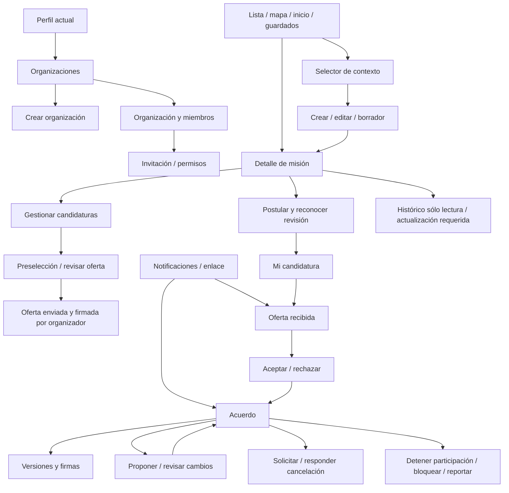

# U0 — Navegación y diseño funcional para revisión

Estado: **PROPUESTA; FLUTTER NO AUTORIZADO**. El prototipo `U0/index.html` sólo representa pantallas con datos sintéticos; no autentica, firma, reserva, publica, reporta ni llama al backend. No es evidencia de implementación validada.

## Identidad visual y superficies

Se reutilizan logo MAREA y NunitoSans del repositorio. Tokens leídos de AppColors/AppTheme/AppSpacing/AppRadius: navy #0B255E, acción #0D4397, aqua #22C5C1, fondo paper #FAF9F6, texto #102149, borde suave #E9E8E4; tarjetas de 24 px, inputs/botones de 16 px y altura mínima 52 px, espaciado 4/8/12/16/24/32. Sin nueva marca ni reorganización de la navegación principal. AppShell conserva Inicio, Explorar, Misiones, Mapa y Perfil, con Crear y las utilidades actuales de guardados/notificaciones. Las rutas de detalle fuera de Shell conservan Volver; el prototipo no añade dock a esos flujos. El prototipo permite inspección móvil y escritorio, contexto personal/organizacional y estados; la equivalencia Flutter aún debe verificarse en U1.

## Mapa de navegación propuesto

Los destinos antiguos /missions/:id, /apply, /sent, /manage y /edit se conservan, con resolución autorizada del recurso. Rutas propuestas adicionales: /organizations, /organizations/new, /organizations/:id, /organizations/:id/members, /invitations/:id, /offers/:id, /agreements/:id y sus revisiones/cancelaciones/historial. Reportes usan entrada contextual con identificadores validados, nunca una URL arbitraria del push.

Volver conserva filtros y borrador, no reproduce una mutación. Enlace/notificación resuelve sesión → capacidad del cliente → permiso actual → recurso; si falta sesión, retorno tras login al mismo destino, sujeto a nueva autorización. Si falta permiso, no renderizar términos cacheados. Compartir una misión sólo comparte su proyección pública, jamás aceptación, candidaturas o contrato.

## Inventario revisable

| ID | Interfaz | Cambio y salida |
|---|---|---|
| U01 | Lista de misiones / tarjetas / mapa | Existente: titular, reservas y acuerdos diferenciados; detalle o crear |
| U02 | Selector de contexto | Nueva hoja: persona siempre disponible; sólo organizaciones con facultad actual; vuelve a acción pendiente |
| U03 | Organizaciones | Nueva lista desde perfil; crear/detalle/invitación |
| U04 | Crear organización | Nombre y responsable; no fusiona identidad personal |
| U05 | Organización | Estado de operación/propiedad; misiones y miembros autorizados |
| U06 | Miembros y permisos | Roles mínimos, facultades de firma separadas, invitar/revocar; última propiedad con flujo controlado |
| U07 | Invitación | Parte invitante, rol, permisos y vigencia; aceptar/rechazar, sin incorporación silenciosa |
| U08 | Crear / editar misión y borrador | Existente: contexto fijo, titular, plazo, contenido y revisión; borrador local versus servidor |
| U09 | Detalle de misión | Existente: titular, condiciones públicas y cupos; postular o gestionar según permiso |
| U10 | Postulación | Existente: disponibilidad/evidencia, revisión conocida, reconocimiento material antes de continuar |
| U11 | Mi candidatura / envío | Existente: enviada/preseleccionada/oferta separadas; ninguna equivale a contrato |
| U12 | Gestión de candidaturas | Existente: revisar → preseleccionar → oferta individual; no confirmar lote ni firmar por candidata |
| U13 | Revisar y emitir oferta | Nueva: destinatario, condiciones exactas, plaza, 72h y aceptación organizadora expresa |
| U14 | Oferta enviada | Nueva: pendiente de destinataria, firma organizadora y vencimiento; retirar autorizado |
| U15 | Oferta recibida | Nueva: términos exactos, parte responsable, límite; aceptación/rechazo personal |
| U16 | Acuerdo | Nueva: estado actual, oferta histórica, revisión vigente, partes y acciones por permiso |
| U17 | Propuesta material / revisión | Nueva: antes/después, plazo, firmas parciales; anterior continúa vigente |
| U18 | Historial | Nueva: revisiones y firmas históricas, sin acceso privado de terceros |
| U19 | Solicitud de cancelación | Nueva: motivo y aviso; no termina automáticamente; contraparte acepta/rechaza |
| U20 | Seguridad | Nueva: detener participación, bloquear y reportar sin consentimiento abusivo; no declarar culpabilidad |
| U21 | Caso/incidencia | Propuesta de entrada contextual y número de caso; resolución administrativa no habilitada sin política |
| U22 | Notificaciones | Existente: oferta/cambio/cancelación diferenciados, destinos autorizados sin payload contractual |
| U23 | Histórico legado | Nuevo estado de detalle: selección legada no es acuerdo; revisión pendiente, sin acciones contractuales |
| U24 | Actualización requerida | Nuevo estado transversal: no continuar con estados incompatibles; volver a superficie segura |
| U25 | Responder cancelación | Nueva: contraparte acepta expresamente o rechaza conservando acuerdo |
| U26 | Reconocer revisión de misión | Nueva: comparación de términos, reconocimiento separado de firma contractual |
| U27 | Cierre/cancelación de misión | Modificada: efectos separados en ofertas pendientes y acuerdos activos |
| U28 | Borrador | Modificada: estado local/servidor y conflicto antes de publicar |

En el prototipo, Inicio/Explorar/Mapa reutilizan la muestra de tarjeta/listado U01 y Perfil abre el acceso propuesto a Organizaciones: son atajos de revisión, no una sustitución de sus pantallas reales. No se propone rediseñar esas superficies.

Perfil sólo añade acceso a Organizaciones; no se rediseñan onboarding ni otros módulos. Guardados, mapa y feed conservan su estructura con DTO/proyecciones correctos. Reacciones/comentarios existentes se preservan y no se convierten en chat contractual privado.

## Flujos completos

### Organizador autorizado personal u organizacional

Entrada lista/perfil → escoger contexto → crear/guardar borrador → publicar con confirmación servidor → recibir candidaturas → revisar → preseleccionar → revisar términos y destinataria → consentir «Enviar oferta y aceptar estas condiciones» → envío pendiente de respuesta → consultar aceptación/rechazo/vencimiento → acuerdo/historial.

El selector muestra la persona humana actuante y, cuando corresponda, la organización representada. Cambiar contexto requiere nueva verificación y no transforma titularidad ni borra un borrador. En una misión existente manda su titular, no una preferencia global. Nunca exigir organización a la persona que gestiona su propia misión.

### Candidata

Descubrimiento/enlace → detalle → postular personalmente → confirmar disponibilidad/revisión/evidencia → envío real → candidatura → notificación/oferta → leer términos completos y vencimiento → aceptar/rechazar → resultado autenticado → acuerdo activo o candidatura con oferta terminada. No hay confirmación optimista ni firma del organizador por la candidata.

### Cambio material

Misión: edición material → advertencia de efectos → revisión nueva y ofertas afectadas terminadas → candidata ve diferencias y reconoce revisión → organizador puede emitir nueva oferta cuando estado lo permita.

Acuerdo: detalle → proponer condiciones → revisar diff y aceptar expresamente por parte propia → propuesta pendiente → contraparte revisa → aceptación dentro de plazo promueve revisión; rechazo/retiro/expiración conservan revisión previa. Mostrar ambas revisiones mientras negocian. Cambiar contraparte no se ofrece como edición ordinaria.

### Cancelación y seguridad

Acuerdo → solicitar cancelación con motivo → aviso → contraparte responde → cancelación bilateral sólo con consentimiento exigido. Rechazar la solicitud conserva acuerdo; mostrar estado independiente de solicitud.

Seguridad: acuerdo/perfil contextual → detener participación o bloquear/reportar inmediatamente → confirmación de la acción realizada y estado del caso. Detener participación no declara acuerdo cancelado, incumplimiento probado ni indemnización. Bloqueo no borra firmas/evidencias y no exige retirar denuncia. Sin promesa de atención continua; horarios y contactos reales pendientes de política operativa. El diseño no inventa servicios de emergencia ni resoluciones administrativas.

### Organización y privacidad

Crear → organización → miembros → invitación → aceptación del receptor → facultades vigentes. Revocar conserva firma histórica; la persona pierde acciones futuras. Organización sin propiedad/representación válida o suspendida muestra restricción y no admite obligaciones nuevas. Transferencia requiere consentimiento y reautenticación: interfaz/proceso completo queda ligado a sus dependencias de seguridad, no se presume implementado en TASK-002.

La solicitud de eliminación siempre puede presentarse. Estado/seguimiento de privacidad explica recursos pendientes sin exigir mantener perfil público. Expedientes activos se conservan sólo bajo causa y plazo aprobado, no como retención indefinida. No se reutiliza author_id como dueño organizacional al eliminar un representante.

## Estados y acciones

| Estado | Lectura | Acción crítica y salida |
|---|---|---|
| Carga | Esqueleto, sin términos anteriores de otro contexto | Deshabilitada hasta permiso/recurso actual |
| Vacío | Explicación contextual y siguiente paso autorizado | Crear/postular sólo cuando corresponde |
| Error de red | Mensaje localizado y reintento | No simular éxito ni nueva clave al reintentar misma operación |
| Offline | Sólo contenido público cacheado con fecha; borrador local protegido | Oferta, firma, publicación, cancelación, membresía y reporte no se encolan; puede detener físicamente participación, pero la app no afirma registro servidor sin respuesta |
| Permiso perdido | Retirar contenido privado y acciones | Volver; volver a resolver contexto válido |
| Conflicto / revisión cambiada | Informar nueva revisión y conservar aportación | Revisión/consentimiento renovado, no sobrescritura silenciosa |
| Envío en curso | Evitar doble clic y mostrar progreso | Reintentar con misma clave; conciliar resultado servidor antes de declarar fallo definitivo |
| Vencimiento | Fecha de servidor y resultado terminal | Aceptación denegada; no extender TTL por UI |
| Éxito | Sólo postconfirmación backend real en futura implementación | Oferta enviada no dice «contratado»; cancelación solicitada no dice «cancelado» |
| Cliente incompatible | Pantalla de actualización localizada | Lectura contractual bloqueada; regreso seguro |

El contador es informativo; siempre mostrar fecha/hora y zona, y volver a consultar al recuperar foco/red. La cuenta atrás no demuestra elegibilidad para aceptar.

## Textos, permisos y accesibilidad

- Etiquetas: «Como persona», «En representación de…», «Oferta pendiente de tu respuesta», «Acuerdo activo», «Oferta aceptada el…», «Solicitud de cancelación», «Participación detenida por seguridad».
- Permisos mínimos: mission.manage, application.review, agreement.offer y facultad de aceptación organizadora para emitir; agreement.accept para firma organizacional; candidata firma exclusivamente por sí misma. La ausencia de acciones UI no sustituye controles servidor.
- Explicar compensación como declarada; MAREA no gestiona/verifica pagos ni garantiza cumplimiento externo.
- Teclado/foco visible, labels, contraste, objetivos >=48px, texto ampliable, fechas inequívocas y anuncios accesibles de resultado. El prototipo no acredita WCAG integral ni lectores móviles.
- Cachés: separar contextos; no recuperar privados tras perder permiso; app nueva corrige estado legado al actualizar/reconectar. No prometer reparar una pantalla offline inalcanzable de un binario antiguo.

## Entregable y puerta de aprobación

Revisar prototipo, navegación U01–U28, decisiones sobre permisos/acciones y estados. U0 queda **ENTREGADO_PARA_REVISION**, no aprobado. La futura equivalencia Flutter y QA en dispositivos se verificarán en U1; la preparación de U0 no bloquea diseño backend, pero no autoriza implementarlo. Ninguna pantalla del producto se ha modificado.
