# Manual Técnico de Software

**MAREA** · Versión documental 1.1 · 11 de noviembre de 2026

Cliente multiplataforma, backend de datos y servicios de procesamiento

<a id="cap-00"></a>
## 00 · Control documental

| Campo | Valor |
|---|---|
| Producto y paquete | MAREA · `marea` |
| Versión de la aplicación | `1.0.0+1`, declarada en `pubspec.yaml` |
| Revisión base | `e27f6ae4e3fb2a63f7287bbd486e989745bab216` |
| Fuente inspeccionada | Árbol de trabajo del 11 de noviembre de 2026, incluidos los cambios locales de Mapbox |
| Historial documental | 1.0 · Primera edición; 1.1 · Auditoría de contratos, operación, pruebas y edición |

**VERIFICADO** indica lectura directa de la implementación o una comprobación ejecutada, según se indique. **INFERIDO** identifica una consecuencia razonada a partir del código. **PENDIENTE DE VALIDACIÓN** identifica una comprobación que depende de infraestructura, credenciales, dispositivo o confirmación externa. **DESACTUALIZADO** marca una afirmación anterior que contradice la fuente actual; se conserva su explicación en la auditoría. Una evidencia histórica se cita con su fecha y alcance. «Verificado en código» no acredita una operación remota ni el cumplimiento completo de un requisito.

En las referencias, las rutas parten de la raíz de MAREA. En las figuras, las flechas indican dependencias, mensajes o claves foráneas según el tipo de diagrama. En el PDF, el índice y los marcadores llevan a capítulos y subsecciones. La matriz distingue cobertura documental, implementación observada y resultado de pruebas. La edición 1.0 se conserva en [el archivo de versiones](versiones/README.md); las diferencias se registran en [cambios de v1.1](cambios-v1.1.md).

<!-- indice -->

- [00 · Control documental](#cap-00)
- [01 · Introducción](#cap-01)
- [02 · Visión general del sistema](#cap-02)
- [03 · Arquitectura de software](#cap-03)
- [04 · Tecnologías y dependencias](#cap-04)
- [05 · Organización del código fuente](#cap-05)
- [06 · Diseño e implementación de módulos](#cap-06)
- [07 · Arquitectura y modelo de datos](#cap-07)
- [08 · APIs y comunicación externa](#cap-08)
- [09 · Instalación y configuración](#cap-09)
- [10 · Compilación y despliegue](#cap-10)
- [11 · Seguridad del sistema](#cap-11)
- [12 · Pruebas y aseguramiento de calidad](#cap-12)
- [13 · Operación y mantenimiento](#cap-13)
- [14 · Limitaciones, riesgos y deuda técnica](#cap-14)
- [15 · Anexos técnicos](#cap-15)

<!-- fin-indice -->

<a id="cap-01"></a>
## 01 · Introducción

**VERIFICADO.** MAREA reúne perfiles, publicaciones y fichas profesionales con oportunidades de participación llamadas *misiones*. Permite descubrir contenido, colaborar, intercambiar mensajes y, para los flujos habilitados, editar y visitar recorridos panorámicos. Las funciones disponibles dependen de la sesión, el tipo de perfil, la propiedad y el estado del recurso. La interfaz y los contratos de datos corresponden al cliente Flutter, las migraciones y las funciones del repositorio. Véanse `lib/main.dart` · `startMarea()`, `lib/core/router/app_router.dart`, `supabase/migrations/001_initial_schema.sql`, `003_community.sql` y `015_tours.sql`.

El manual está dirigido a un ingeniero que recibe el sistema para mantenerlo, reproducir su entorno o preparar una entrega. Los requisitos de producto y su seguimiento se consultan en [MAREA_SRS.md](../MAREA_SRS.md) y [MAREA_REQUIREMENTS_STATUS.yaml](../MAREA_REQUIREMENTS_STATUS.yaml). Un requisito se presenta como comportamiento disponible solo cuando se identifica su camino de ejecución. La [auditoría técnica](auditoria-tecnica.md) y la [matriz de trazabilidad](matriz-trazabilidad.md) amplían la evidencia de esta edición.

### 1.1 Alcance y fuente de verdad

**VERIFICADO · código y documentación.** La unidad documentada es el árbol local sobre la revisión base, incluidas las modificaciones de Mapbox. La SRS vigente se identifica como 5.1.1 y describe también capacidades por construir: organizaciones, ofertas bilaterales y acuerdos no se pueden deducir de los perfiles, candidaturas o pantallas actuales. La matriz usa sus IDs como referencia de intención y explicita las diferencias; no reemplaza el registro normativo `docs/MAREA_REQUIREMENTS_STATUS.yaml`.

**Límite de esta edición.** Se inspeccionan cliente, configuración nativa, migraciones, seis funciones y worker. Las comprobaciones ejecutadas son locales y usan dependencias simuladas. No se inspeccionó un catálogo SQL remoto ni se desplegaron servicios. La selección de fragmentos y contratos prioriza los puntos que afectan permisos, consistencia, recuperación y extensión del sistema.

<a id="cap-02"></a>
## 02 · Visión general del sistema

**VERIFICADO.** El modelo de perfil distingue `Usuario general`, `Artista / creador`, `Emprendedor` y `Negocio`. El rol de aplicación `user` o `admin` es un atributo separado. Autor, organizador, postulante, interlocutor y revisor representan relaciones con un recurso. La base y las RPC aplican estas relaciones en cada dominio. Véanse `001_initial_schema.sql` · restricciones de `profiles`, `003_community.sql`, `013_missions_redesign.sql`, `015_tours.sql`, `022_private_chat.sql`.

| Área | Capacidad que se puede seguir desde el código |
|---|---|
| Acceso y perfil | Registro, confirmación, recuperación, OAuth Google, política legal, configuración inicial, edición y eliminación de cuenta. |
| Comunidad | Publicaciones, fichas, guardados, reacciones, comentarios, colaboración, reportes y moderación. |
| Inicio y descubrimiento | Feed paginado, seguimiento, historias, búsqueda y mapa de misiones con filtros. |
| Misiones | Creación, borradores, edición, postulación, finalistas, selección y cambios de estado. |
| Comunicación | Solicitudes de chat, conversación, bloqueos, reportes, avisos internos y push Android condicionado. |
| Recorridos | Editor, panoramas conectados, captura guiada móvil, importación GPano, solicitudes y RA móvil compatible. |

*Tabla 1. Capacidades rastreadas desde el cliente. Las referencias por módulo figuran en el capítulo 06 y en la matriz.*

**PENDIENTE DE VALIDACIÓN.** Las pruebas con dispositivos físicos, cartografía real y servicios activos se gestionan por plataforma. La existencia de una ruta o una configuración de compilación permite identificar una capacidad de código. Su disponibilidad en un entorno distribuido requiere las comprobaciones del capítulo 10.

<a id="cap-03"></a>
## 03 · Arquitectura de software

**VERIFICADO.** `startMarea()` inicializa Flutter y Mapbox y configura rutas Web sin fragmento. `_StartupAppState._initializeApp()` valida `AppConfig`, inicializa Supabase e inyecta repositorios en `AppSessionController`. `MareaApp` conecta la sesión con `GoRouter`; el shell adapta navegación y vistas. El controlador de sesión y controladores como `MissionMapController`, `NotificationsController` y `PushController` usan `ChangeNotifier`. La UI también conserva estado local en widgets. Véanse `lib/main.dart`, `lib/app.dart`, `lib/core/router/app_router.dart` y `lib/core/session/app_session_controller.dart`.

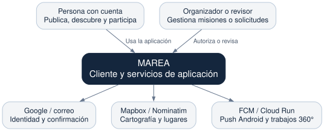

*Figura 1. Contexto C4. Las personas interactúan con MAREA y sus servicios externos mediante el cliente, el backend o los procesos de servidor.*

**VERIFICADO.** Los repositorios traducen modelos Dart a llamadas de Supabase Auth, Data API, RPC, Storage, Edge Functions y streams de tablas. Las reglas que deben sostenerse ante varios clientes se implementan en PostgreSQL mediante restricciones, transacciones y políticas. Las Edge Functions median operaciones con privilegios o integraciones. El worker 360° ejecuta trabajo fuera de la petición de usuario. Véanse `lib/features/chat/data/chat_repository.dart` · `changes()`, `supabase/functions/`, `processing/tours/worker.py` · `process_job()`.

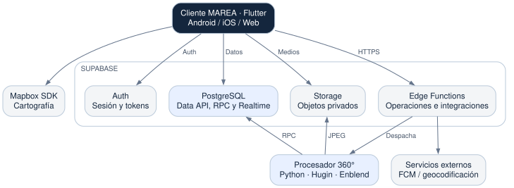

*Figura 2. Contenedores C4. Supabase reúne servicios con contratos distintos. El worker se ejecuta por separado y vuelve a Supabase para obtener trabajo y registrar resultados.*

**INFERIDO.** El patrón observable es una arquitectura modular por funcionalidad con repositorios inyectados, estado de presentación y reglas compartidas en la base. Las dependencias se ensamblan en el arranque. Las interfaces de repositorio facilitan sustituir el límite de I/O en pruebas y la separación del renderer de mapa permite probar filtros, gestos y resultados sin GPU.

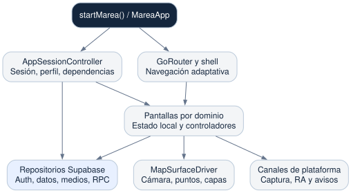

*Figura 3. Componentes del cliente. Las pantallas consumen controladores y repositorios, con adaptadores específicos para cartografía y funciones nativas.*

**VERIFICADO.** Las operaciones que compiten por estado usan mecanismos acordes con su dominio. El mapa descarta respuestas de generaciones antiguas. El chat y los avisos pueden observar cambios con streams. La selección de una misión bloquea su fila y valida cupo. Push y tours reclaman trabajo en base y comprueban la vigencia antes de completar. Los errores se traducen en el cliente con `AppFailureMapper`, `communityFailure()` y mapeos especializados. Véanse `lib/core/errors/app_failure.dart`, `lib/features/map/application/mission_map_controller.dart`, `013_missions_redesign.sql`, `014_android_push.sql` y `015_tours.sql`.

### 3.1 Ciclo de vida y propiedad del estado

**VERIFICADO · código.** El arranque es una frontera de composición: crea un `SupabaseClient` compartido y los repositorios que consumen la misma sesión. El controlador no contiene una copia completa del backend; conserva identidad, perfil, consentimiento, mensajes de error y dependencias del cliente. Las pantallas poseen estados locales como formularios, carga y selección. El router escucha cambios del controlador y decide el destino sin sustituir la autorización del servidor.

`AppSessionController.initialize()` carga la política y se suscribe a Auth. `_loadAuthenticated()` incrementa `_generation`; después de esperar al perfil y al consentimiento descarta resultados si la generación cambió, el controlador se destruyó o desapareció el usuario. Cerrar sesión, eliminar cuenta y `dispose()` invalidan trabajo pendiente. `dispose()` cancela la suscripción y libera los controladores de notificaciones y push. Este mecanismo evita que una respuesta tardía restaure la identidad anterior; no cancela por sí solo una operación que ya llegó a PostgreSQL.

**Evidencia.** `lib/main.dart` · `_initializeApp()`; `lib/core/session/app_session_controller.dart` · `initialize()`, `_loadAuthenticated()`, `_unauthenticated()`, `dispose()`; `test/core/session/app_session_controller_test.dart`.

### 3.2 Contratos de concurrencia y fallos

| Frontera | Garantía observada y límite |
|---|---|
| Cliente asíncrono | Contadores de generación descartan respuestas obsoletas en sesión y mapa. El estado de la UI no es un bloqueo distribuido. |
| Selección de misión | `FOR UPDATE` serializa la comprobación de capacidad y las aceptaciones de esa misión dentro de una transacción. |
| Publicación de historia | Un bloqueo asesor por UUID y un recibo con huella del contenido distinguen reintento y conflicto. La subida a Storage es una operación separada. |
| Trabajo 360° | Reclamo global de hasta dos trabajos, lease de 16 minutos y token vigente para completar; una guarda de escritura protege la carga de resultados frente a la baja. |
| Push | Cola con lease, comprobación de vigencia antes de enviar y finalización por resultado. El envío HTTP y la confirmación SQL no forman una transacción única. |

*Tabla 10. Mecanismos de concurrencia. Evidencia: migraciones 013, 014, 015, 036 y controladores de sesión y mapa. Las garantías remotas requieren pruebas del entorno.*

**VERIFICADO · código.** Los repositorios normalizan excepciones mediante `AppFailureMapper`, `communityFailure()` o reglas de dominio. Es necesario conservar la distinción entre sesión inválida, contrato desactualizado y fallo transitorio: una falta de RPC no se resuelve reintentando indefinidamente. Los controladores pueden conservar resultados anteriores mientras presentan un error; no debe interpretarse esa vista como confirmación de una nueva escritura.

**INFERIDO · mantenimiento.** Añadir una capacidad exige ensamblar su dependencia en el arranque, definir contrato y permisos en el servidor y comprobar respuestas tardías y cierre de sesión en la presentación. Los adaptadores de mapa y repositorio son los puntos de sustitución existentes para pruebas; no hay evidencia de un bus de eventos general ni de una capa universal de sincronización offline.

<a id="cap-04"></a>
## 04 · Tecnologías y dependencias

**VERIFICADO.** Las restricciones con `^` corresponden a `pubspec.yaml`, las versiones resueltas a `pubspec.lock`. El SDK observado para esta inspección coincide con la revisión declarada en `.metadata`. Los componentes nativos y del worker tienen sus propios archivos de referencia.

| Tecnología | Versión o restricción identificada | Responsabilidad | Evidencia |
|---|---|---|---|
| Flutter y Dart | 3.44.1 / 3.12.1 en SDK local. El lockfile requiere Flutter desde 3.44.0, Dart desde 3.12.1 y menor que 4.0.0 | Runtime, widgets Material y toolchain | `.metadata`, `pubspec.lock`, SDK local |
| `supabase_flutter` | `^2.17.2` a `2.17.2` | Auth, datos, RPC, medios y Realtime | `pubspec.yaml`, `pubspec.lock` |
| `go_router` | `^17.4.0` a `17.5.0` | Rutas, shell y redirecciones | `pubspec.lock`, `app_router.dart` |
| Mapbox Flutter / Web | `3.34.2` / `3.34.2` | Renderizado cartográfico y cámara | `pubspec.lock`, `lib/core/maps/` |
| Geolocator / latlong2 | `14.0.3` / `0.9.1` | Ubicación puntual y geometría | `pubspec.lock`, `lib/core/location/` |
| Firebase Core / Messaging | `4.15.0` / `16.7.0` | Inicialización y push Android | `pubspec.lock`, `android_push_gateway.dart` |
| Avisos locales / preferencias | `22.3.1` / `2.5.5` | Presentación de avisos y persistencia local | `pubspec.lock`, `lib/features/notifications/` |
| Camera / Panorama Viewer | `0.12.1` / `2.0.7` | Captura y visita panorámica | `pubspec.lock`, `lib/features/tours/` |
| Image Picker / File Selector | `1.2.3` / `1.1.0` | Selección de imágenes o archivos | `pubspec.lock`, `profile_media_repository.dart` |
| Android | Gradle `9.1.0`, AGP `9.0.1`, Kotlin `2.3.20`, JVM objetivo `17`, `minSdk 24` | Compilación, identidad y canales nativos | `android/settings.gradle.kts`, `android/app/build.gradle.kts`, wrapper |
| iOS | Objetivo `15.0`, Mapbox Maps iOS `11.34.2` | Runner y dependencias SwiftPM | `ios/Runner.xcodeproj/project.pbxproj`, `Package.resolved` |
| Python y herramientas 360° | Python `3.12` sobre Bookworm. Pillow `11.3.0`, NumPy `2.2.6`, Requests `2.32.5` | Validación, proyección y exportación JPEG. Hugin y Enblend se instalan en la imagen | `processing/tours/Dockerfile`, `requirements.txt` |
| Node y YAML | Node `24` en la guía, YAML `2.9.1` fijado | Gate, pruebas y trazabilidad de requisitos | `tool/README.md`, `tool/traceability/package.json` |

*Tabla 2. Versiones declaradas, resueltas u observadas según la evidencia. La versión del PostgreSQL alojado y del runtime remoto de Edge Functions quedan pendientes de validación.*

### 4.1 Reproducibilidad de versiones

**VERIFICADO.** Esta edición ejecutó Node 24.14.0, Python 3.12.14 para el worker y Flutter 3.44.1/Dart 3.12.1. Son versiones del entorno de comprobación; no convierten en requisito una herramienta que el proyecto no fija. El Dockerfile fija la familia Python 3.12, pero la etiqueta base y las herramientas de sistema no constituyen un cierre inmutable por digest. Las Edge Functions importan `jsr:@supabase/supabase-js@2`; ese rango mayor no fija una versión exacta de parche. No se encontró un lockfile de Deno junto a las funciones.

Al reproducir una incidencia, registrar SDK, lockfiles, revisión y variante. El build móvil incorpora también Gradle o SwiftPM; un `pubspec.lock` idéntico no demuestra que dos compilaciones nativas sean iguales. Para la edición documental, las versiones y el comando independiente están en [regeneración](edicion/README.md).

<a id="cap-05"></a>
## 05 · Organización del código fuente

**VERIFICADO.** `lib/main.dart` es la entrada ordinaria. Los arneses de mapa y RA residen en `test/`. `lib/core/` mantiene servicios compartidos, enrutamiento, sesión y configuración. Los dominios agrupan modelos, acceso a datos y presentación según su tamaño.

```text
lib/
  main.dart, app.dart     Arranque y raíz de la aplicación
  core/                   Configuración, rutas, sesión, mapas y errores
  features/
    auth, legal, profile  Acceso, consentimiento y perfil
    community, showcase  Publicaciones, misiones, moderación y fichas
    home_feed, discover  Inicio, historias y descubrimiento
    map, location        Consulta geográfica y geocodificación
    chat, notifications  Conversaciones, bandeja y push
    tours, shell         Recorridos, RA y navegación adaptativa
  shared/widgets/         Componentes reutilizables
android/, ios/, web/      Entradas y configuración por plataforma
supabase/
  migrations/            Esquema y contratos SQL
  functions/             Edge Functions TypeScript
  email-templates/       Plantillas de Auth
processing/tours/        Imagen, worker, scripts y pruebas 360°
config/                  Ejemplos de configuración
assets/                  Marca, fuentes e introducción
test/                   Pruebas y arneses de QA
tool/                   Gates, verificadores y laboratorios
docs/                   Documentación y evidencia histórica
```

Para localizar una operación, partir de la ruta y seguir la construcción de la pantalla. Buscar el método del repositorio y el literal que identifica la tabla, RPC, bucket o función. Revisar las redefiniciones SQL posteriores y la prueba asociada antes de deducir el contrato efectivo. Los anexos ofrecen referencias para los flujos más sensibles.

<a id="cap-06"></a>
## 06 · Diseño e implementación de módulos

### 6.1 Acceso, consentimiento y perfil

**VERIFICADO.** `SupabaseAuthRepository` conecta correo y contraseña, confirmación, recuperación y OAuth con Auth. El registro mínimo usa metadatos para que el trigger inicialice el perfil y confirme el tipo cuando la entrada cumple su contrato. `SupabaseLegalRepository` consulta `registration_policy` y registra la aceptación de las versiones vigentes mediante `accept_current_legal`. El controlador carga la política y el perfil, escucha cambios de sesión, normaliza fallos y limpia localmente una sesión identificada como inválida. Las pantallas de registro y configuración validan los campos antes de enviar. El servidor vuelve a aplicar restricciones de tipo, nombre y username. Véanse `lib/features/auth/data/auth_repository.dart`, `lib/features/legal/legal_repository.dart`, `lib/core/session/app_session_controller.dart`, `002_account_completion.sql`, `007_minimal_registration.sql` y `008_recover_minimal_registration.sql`.

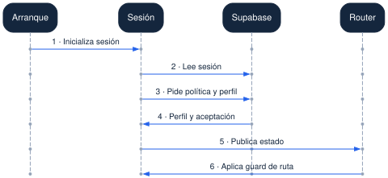

*Figura 4. Secuencia de restauración de sesión. El controlador informa al router cuando termina la carga. Las rutas legales públicas siguen accesibles durante el proceso.*

**VERIFICADO.** `AppRouter.redirectFor()` prioriza inicialización, acceso, recuperación, aceptación legal y onboarding para rutas protegidas. El guard admite destinos internos de contenido según una lista de rutas. `SupabaseProfileRepository` carga la fila propia y usa `community_profiles` para los datos de presentación de terceros. Avatar y portada utilizan `SupabaseProfileMediaRepository`; primero se obtiene la ruta del medio y luego se actualiza el perfil. La función evita eliminar una imagen aún referenciada. Un fallo de carga legal deja un estado de política no disponible y se puede reintentar. Véanse `app_router.dart`, `profile_repository.dart`, `profile_media_repository.dart`, `supabase/functions/profile-media/index.ts` y `035_profile_public_interests.sql`.

#### Contrato de acceso y mantenimiento

**VERIFICADO · código.** La entrada combina eventos de Auth, formulario y URL de retorno. La salida es un estado de sesión y una redirección. Las páginas legales públicas se admiten antes de los guards; recuperación prevalece sobre consentimiento y onboarding. La ruta `/settings` sigue permitida cuando falta aceptación legal. El modo piloto desactiva OAuth y la detección automática de sesión en URI; desarrollo filtra callbacks y separa la clave de almacenamiento.

Los cambios de perfil y medios son operaciones separadas: subir una imagen no actualiza automáticamente `avatar_path` ni `cover_path`. Una limpieza fallida debe reintentarse preservando la referencia vigente. El controlador borra la sesión local ante un error clasificado como sesión inválida; un fallo de red o de contrato no demuestra revocación del usuario.

**Pruebas y extensión.** `test/core/router/app_router_test.dart`, `test/core/router/account_routes_test.dart`, `test/core/config/legal_policy_test.dart` y `test/core/session/registration_safety_test.dart` ejercitan estos límites con dependencias simuladas. Al agregar una ruta privada, comprobar sesión inicial, recuperación, consentimiento, onboarding y retorno permitido. La baja coordinada se explica en §11.2.

### 6.2 Comunidad, descubrimiento y escaparates

**VERIFICADO.** `SupabaseCommunityRepository` crea, edita, lista y consulta publicaciones y misiones. Las publicaciones se validan según el tipo de contenido y se persisten con autor, texto, categoría y campos opcionales de ubicación e imagen. Guardados y reportes se almacenan por usuario. `SupabaseSocialRepository` gestiona reacciones, comentarios e interés de colaboración, y devuelve las proyecciones necesarias para pintar contadores, estados y avisos. RLS y RPC determinan qué cuenta puede escribir y qué contenido puede ver. La moderación depende del rol y distingue contenido reportado de las operaciones para ocultarlo. Véanse `lib/features/community/data/`, `lib/features/community/presentation/moderation_screen.dart`, migraciones `003`, `009`, `010` y `011`.

**VERIFICADO.** `SupabaseShowcaseRepository` administra fichas profesionales y fotos independientes de las publicaciones. Una ficha tiene dueño, tipo, estado y disponibilidad. El detalle y las operaciones de guardar o editar consultan contratos diferenciados. La búsqueda usa las proyecciones de comunidad y escaparate disponibles para la cuenta. El medio se lee según visibilidad y permisos del bucket. Véanse `lib/features/showcase/data/showcase_repository.dart`, `lib/features/discover/presentation/`, `006_profile_experience.sql`.

#### Publicación, visibilidad y medios

**VERIFICADO · código.** La entrada es un formulario de publicación o ficha con contenido, clasificación y rutas de objetos; las salidas son IDs y proyecciones para lista o detalle. Los repositorios no conceden permisos por el hecho de que un widget o botón exista. El permiso efectivo depende de identidad, propiedad, visibilidad y estado que consultan las RPC o las políticas.

En escaparates, `save_showcase(item_input,item_id)` valida el tipo permitido para el perfil y bloquea la fila existente cuando se edita. Las imágenes se ordenan mediante la clave `(item_id,position)`, con posiciones 0–5 y ruta única. El propietario puede gestionar borradores; la consulta pública exige las condiciones de publicación y visibilidad. Un guardado por usuario es una relación separada de la propiedad.

**Evidencia.** `lib/features/showcase/data/showcase_repository.dart`; `supabase/migrations/006_profile_experience.sql` · `save_showcase`, políticas de `showcase_items`, `showcase_images` y `showcase_saves`. Las pruebas `test/features/showcase/showcase_flow_test.dart` contienen siete fallos actuales: no certifican el flujo completo. `test/features/profile/profile_tools_test.dart` y `profile_redesign_test.dart` cubren la presentación actual con fixtures. Al extender el modelo, revisar también modelos JSON, medios, búsqueda, guardados y enlaces desde recorridos.

### 6.3 Inicio, seguimiento e historias

**VERIFICADO.** `SupabaseHomeFeedRepository.page()` valida filtros y envía `filters` y `page_cursor` a `home_feed`. El servidor devuelve una página de contenido mixto a partir de candidatos y un snapshot asociado al usuario. El cliente distingue `feed_cursor_expired` para solicitar una actualización. El seguimiento usa `set_profile_follow` y el estado se consulta bajo permisos de la cuenta. Véanse `lib/features/home_feed/data/home_feed_repository.dart` y `016_home_feed.sql`.

**VERIFICADO.** `SupabaseStoriesRepository` carga `stories` y `server_time`, prepara rutas de imagen por autor e ID, y envía cinco argumentos a `publish_story`. Un recibo persistente permite distinguir el reintento de un cambio de contenido. Las vistas, reportes, moderación y limpieza siguen contratos separados. La visibilidad se acota por el estado de la historia y su expiración. La limpieza quita imágenes, filas vencidas o eliminadas y snapshots expirados. Véanse `stories_repository.dart`, migraciones `016`–`019` y `034_story_metadata.sql`–`040_restore_story_metadata_columns.sql`, `supabase/functions/story-cleanup/index.ts`.

#### Paginación, reintentos y expiración

**VERIFICADO · código.** `home_feed` recibe filtros y cursor; crea un snapshot ligado al usuario para mantener el orden de IDs. Cada página vuelve a consultar candidatos visibles: el snapshot no concede acceso a contenido que dejó de estar disponible. Devuelve hasta 30 entradas y un cursor adicional cuando existe una siguiente fila. El cursor debe pertenecer al usuario, conservar exactamente los filtros y no haber expirado; de otro modo devuelve `feed_cursor_expired`.

Para historias, el cliente genera el UUID antes de publicar y conserva el mismo ID al reintentar. La subida usa la ruta `<usuario>/<historia>.png`, sin sobrescritura; acepta un conflicto de objeto duplicado como continuación del intento. La RPC comprueba dueño y huella de texto, imagen, categoría y destinatario. Un recibo previo compatible devuelve el UUID sin crear otra historia; un payload diferente produce `story_operation_conflict`. La expiración es de 24 horas y la lectura incorpora `server_time` para interpretar vigencia.

**Evidencia.** `lib/features/home_feed/data/home_feed_repository.dart` · `page()`; `stories_repository.dart` · `upload()`, `publish()`; migraciones `016_home_feed.sql`, `018_story_publication_retries.sql`, `019_story_receipt_upgrade.sql`, `034_story_metadata.sql`, `036_refresh_story_rpc.sql`–`040_restore_story_metadata_columns.sql`. El contrato detallado y su secuencia figuran en §8.2. `test/features/home_feed/home_feed_experience_test.dart` reproduce tres fallos de interacción que se investigan en la auditoría; no implican por sí mismos un fallo SQL.

### 6.4 Misiones y postulaciones

**VERIFICADO.** La creación y la edición preparan un documento de misión validado por RPC. Los borradores pertenecen al autor y registran la misión publicada cuando se materializan. Las postulaciones incluyen mensaje, disponibilidad afirmativa, hasta tres muestras y un ID de operación. Cada muestra apunta a una URL HTTPS válida o a una ficha propia publicada y disponible. `submit_mission_application` valida el contrato y devuelve un UUID. El mismo ID con contenido diferente produce conflicto. La selección comprueba propiedad, disponibilidad temporal, candidaturas pertenecientes a la misión y capacidad. `confirm_mission_selection` bloquea la fila de misión y procesa candidaturas pendientes en la misma transacción. Véanse `community_repository.dart`, `community_models.dart`, `mission_experience.dart`, `005_mission_lifecycle.sql`, `013_missions_redesign.sql` y redefiniciones de creación y borradores en `021_content_cities.sql`.

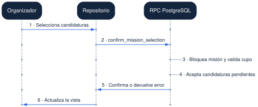

*Figura 5. Secuencia de selección de misión. El servidor comprueba cupo y estado con la fila de misión bloqueada. Los cambios de estado pueden generar notificaciones.*

**VERIFICADO.** El organizador puede marcar finalistas y confirmar selección. La RPC acepta misiones `open` o `closed` mientras cumplan las demás condiciones. La confirmación actual actualiza la candidatura a `accepted` desde la acción del organizador. Reacciones y comentarios de misión usan sus propias tablas y RPC, y la versión de eventos permite distinguir transiciones para avisos. Véanse `013_missions_redesign.sql` · `set_mission_finalist`, `confirm_mission_selection`, `version_mission_event`, `020_mission_social.sql`.

#### Invariantes de postulación y selección

**VERIFICADO · código.** `submit_mission_application` recibe `mission_id` y un JSON con `operation_id`, `message`, `availability_confirmed` y `evidence`. Rechaza claves adicionales, disponibilidad distinta de `true`, más de tres muestras o referencias ajenas/no disponibles. La operación se registra por postulante e ID. Reutilizar esa clave con otra misión o contenido genera `application_operation_conflict`; repetirla con el mismo documento devuelve la candidatura registrada.

La selección admite una lista no vacía de hasta 100 IDs, sin nulos. Comprueba que cada candidatura pertenece a la misión y está pendiente o aceptada; cuenta la unión de aceptadas y seleccionadas antes de llamar a `review_application`. Los duplicados se procesan una vez. `mission_full`, `mission_unavailable` y `mission_owner_required` son resultados diferenciados del servidor. Un error aborta la transacción.

**DESACTUALIZADO como equivalencia normativa.** Interpretar `accepted` como un acuerdo bilateral firmado contradice esta ruta y los requisitos RF-09-005/RF-09-011 de la SRS. La implementación cambia el estado por decisión del organizador. H02 conserva esta discrepancia abierta. Las pruebas `test/features/community/mission_experience_repository_test.dart`, `mission_participation_test.dart` y `mission_permissions_ui_test.dart` verifican contratos y UI simulados; el control concurrente SQL requiere su comprobación específica.

### 6.5 Mapa y geocodificación

**VERIFICADO.** `MissionMapController` combina viewport, texto y filtros. Una búsqueda explícita consulta `list_map_missions`, que considera límites, categoría, fecha y radio, y retorna `missions` y `total`. El contrato limita el resultado a 300 filas y admite límites que cruzan el antimeridiano. La UI conserva resultados al fallar y descarta respuestas obsoletas. Un desplazamiento de cámara puede habilitar «Buscar en esta zona». La ubicación puntual utiliza permisos del dispositivo y el gesto del usuario puede cancelar el recentrado pendiente. Véanse `lib/features/map/application/mission_map_controller.dart`, `mission_map_repository.dart`, `mission_map_models.dart`, `lib/core/location/`, `012_mission_map.sql`.

**VERIFICADO.** `MareaMapSurface` integra Mapbox Standard, estilos y capas, clusters calculados en Dart y selección de puntos. El selector de ubicación utiliza una superficie compartida en modo cenital. Conserva el redondeo de coordenadas aproximadas antes de consultar o guardar. El SDK visual depende de `MAPBOX_ACCESS_TOKEN`. Una Edge Function resuelve la geocodificación. `SupabaseLocationRepository` deduplica solicitudes en curso y cachea respuestas resueltas en memoria. La Edge Function usa caché PostgreSQL y un lease para limitar solicitudes al proveedor. `content_city` usa las coordenadas almacenadas del contenido visible. Véanse `lib/core/maps/`, `post_location_picker.dart`, `location_repository.dart`, `021_content_cities.sql` y `supabase/functions/geocoding/index.ts`.

#### Límites y casos de borde geográficos

**VERIFICADO · código.** El renderer recibe puntos y estado de cámara; las reglas de búsqueda permanecen en el controlador y en `list_map_missions`. El backend exige sur menor que norte, longitudes distintas y coordenadas válidas. Oeste mayor que este expresa cruce del antimeridiano. El radio, cuando se usa, debe ser mayor que cero y no exceder 100 km, con centro válido. El total cuenta todas las coincidencias mientras la lista retorna como máximo 300.

En geocodificación, `search` y `reverse` admiten el flujo previo al registro. `content_city` verifica la sesión, consulta el contenido con el cliente del usuario y compara sus coordenadas antes y después de resolver la ciudad. Un cambio concurrente devuelve `point_changed`. El proveedor utiliza caché y lease compartidos; un resultado `geocoding_busy` no significa que el texto de búsqueda sea inválido.

**Pruebas y mantenimiento.** Los tests de `test/features/map/` sustituyen la superficie por `test/support/fake_map_surface.dart`. Los tests Node de `supabase/functions/geocoding/` simulan proveedor y tiempo. Al cambiar filtros, mantener alineados el modelo, la clave de consulta, el viewport y los parámetros SQL. La carga de estilo, el token y el rendimiento real de Mapbox siguen pendientes por plataforma.

### 6.6 Chat, bandeja y push

**VERIFICADO.** `SupabaseChatRepository` lista conversaciones y mensajes, envía solicitudes y llama a RPC para aceptar, rechazar, enviar, bloquear o reportar. El acceso a lectura se restringe a participantes mediante RLS. `changes()` usa un stream filtrado por conversación; la disponibilidad de eventos depende de la publicación Realtime del entorno. Las redefiniciones SQL ajustan avisos agrupados y censura. `027_disable_chat_bans.sql` retira la comprobación de suspensiones de `chat_active_account`, mientras el bloqueo entre interlocutores permanece en el contrato. Véanse `lib/features/chat/data/chat_repository.dart`, `022_private_chat.sql`–`033_censor_entire_chat_message.sql`.

**VERIFICADO.** La bandeja de la aplicación lee `notifications` y registra lectura. `PushController` controla la sesión del dispositivo, permisos y sincronización de token. `startMarea()` usa `AndroidPushGateway` en Android nativo con configuración ordinaria. Para Web, iOS, desarrollo y piloto utiliza `InboxOnlyGateway`. La cola privada de push reclama trabajos, consulta si siguen vigentes y registra el resultado del envío FCM. El envío requiere configuración del cliente, del worker y activación del entorno. Véanse `lib/main.dart`, `lib/features/community/data/notifications_controller.dart`, `lib/features/notifications/data/`, `014_android_push.sql`, `supabase/functions/send-push/index.ts`.

#### Solicitud de chat y entrega de avisos

**VERIFICADO · código.** El chat parte de una solicitud entre dos perfiles. `send_chat_message(conversation,message_body)` exige participación, estado `accepted`, ausencia de bloqueo vigente y texto recortado de 1–2000 caracteres. Inserta el mensaje, actualiza la actividad y agrupa el aviso mediante `event_key`. La migración 027 retira las tablas de sanciones y palabras prohibidas del diseño inicial; 032 define el emisor actual y 033 sustituye el censor para ocultar todo carácter no blanco cuando detecta una palabra de su lista. Esto no equivale a una moderación semántica completa.

El stream `changes()` observa `chat_messages`, pero su publicación Realtime efectiva no queda demostrada por esa llamada. H08 exige verificar el catálogo del entorno y la recepción entre dos sesiones. Una recarga correcta de mensajes y un evento recibido son pruebas distintas.

Para push, `PushController` vincula permisos, token y preferencias con la sesión. Solo Android nativo ordinario selecciona `AndroidPushGateway`; desarrollo, piloto, Web e iOS usan la bandeja. El worker reclama hasta 20 elementos y limita el envío a cuatro tareas concurrentes; comprueba vigencia antes de llamar a FCM y finaliza cada lease. Un `200` del worker resume procesamiento, no lectura por el destinatario.

**Evidencia.** `lib/features/chat/data/chat_repository.dart`; `lib/features/notifications/data/push_controller.dart`; `supabase/functions/send-push/index.ts`; migraciones `014`, `022`, `027`, `032`, `033`. `test/features/notifications/push_controller_test.dart` comprueba el controlador; la entrega FCM real queda pendiente.

### 6.7 Recorridos 360° y realidad aumentada

**VERIFICADO.** El editor guarda el documento de recorrido, zonas, escenas y puntos de RA. Las capturas y originales tienen acceso restringido. Los envíos y solicitudes guardan una revisión, y la publicación deriva de permisos y decisiones del servidor. La visita recupera escenas enlazadas y registra progreso por revisión y usuario. La RA usa canales `marea/tour_ar` y `marea/tour_ar/events` con Android ARCore o iOS ARKit. El reporte de reconocimiento queda ligado a la versión de referencia y su ancho físico. La captura guiada utiliza canales de movimiento y la importación acepta panoramas con GPano verificado por el worker. Véanse `lib/features/tours/`, `android/app/src/main/kotlin/com/marea/app/TourAR.kt`, `TourNative.kt`, `ios/Runner/AppDelegate.swift`, `015_tours.sql`.

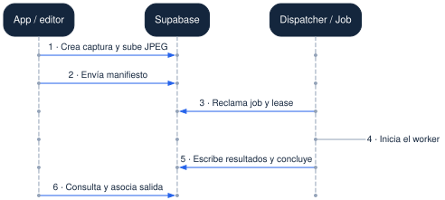

*Figura 6. Secuencia de procesamiento 360°. Captura, reclamación, procesamiento y asociación de salida son pasos separados. El resultado se registra bajo un lease vigente.*

**VERIFICADO.** `tours_capture_begin` y `tours_capture_submit` enlazan captura, manifiesto y job. El dispatcher reclama la cola e invoca Cloud Run. `worker.py` verifica identidad, rutas y metadatos, procesa JPEG importado o une fotos con Hugin y Enblend, y escribe JPEG GPano, preview y miniatura. Comprueba lease antes de escribir y concluir. La cola admite dos trabajos globales y hasta tres intentos por job. Los errores transitorios se pueden reencolar y los datos inválidos producen un resultado terminal. Véanse `supabase/functions/tour-dispatch/index.ts`, `processing/tours/worker.py` · `process_job()`, `015_tours.sql` · `tours_claim_jobs`, `tours_finish_job`.

#### Documento editorial, worker y recuperación

**VERIFICADO · código.** `TourRepository` separa edición, envío a revisión, permisos, progreso, captura, jobs y publicación. El documento JSON contiene zonas, escenas, puntos, conexiones y orden RA; el servidor canoniza campos y no acepta un estado de procesamiento aportado por el cliente. `tour_revisions` conserva la revisión editorial, mientras el recorrido mantiene una referencia pública. Una revisión editorial no es una captura ni un trabajo de procesamiento.

La captura `photos` sube fotografías y manifiesto; `import` exige esfera completa con metadatos GPano. La relación visual 2:1 no basta. El cliente entrega el manifiesto a `tours_capture_submit`; el worker valida entradas, procesa o importa, escribe panorama, vista previa y miniatura, y confirma con el lease. `tours_attach_result` incorpora el resultado al documento: terminar un job no publica automáticamente el recorrido.

Ante un timeout ambiguo del despacho, la función conserva el lease porque Cloud Run puede haber comenzado. La reclamación recupera un lease vencido si no hay escritura protegida; los intentos se limitan a tres. La finalización exitosa reconoce el mismo lease y resultado ya confirmados. `tours_completion_receipt` permite resolver una respuesta de finalización incierta. Las limpiezas también renuevan su lease antes de borrar objetos.

**Evidencia.** `lib/features/tours/data/tour_repository.dart`; `supabase/migrations/015_tours.sql` · `private.tour_document`, `tours_attach_result`, `tours_completion_receipt`, `tours_renew_cleanup`; `processing/tours/worker.py` · `process_job()`; `supabase/functions/tour-dispatch/index.ts`. Los tests del worker simulan I/O externo; `test/features/tours/tour_ar_recovery_test.dart` y `tour_editor_recovery_test.dart` ejercitan recuperación cliente. El reconocimiento físico ARCore/ARKit, cobertura fotográfica y procesamiento integral requieren dispositivos y servicios activos.

<a id="cap-07"></a>
## 07 · Arquitectura y modelo de datos

**VERIFICADO.** PostgreSQL persiste la identidad de aplicación, contenido y trabajos. `profiles.id` referencia `auth.users.id` con borrado en cascada. `public` agrupa tablas y RPC de aplicación, con exposición controlada por permisos y RLS. `private` mantiene estado de servicios como colas, leases y permisos 360°. Los datos binarios se guardan en Storage. Los documentos JSONB son parte del contrato en misiones, historias, snapshots y recorridos según la entidad.

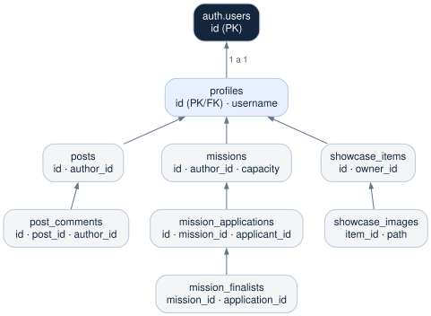

*Figura 7. Claves foráneas principales de identidad, contenido y misiones. Las flechas van de la tabla dependiente a su tabla referenciada.*

| Familia | Identificadores, relaciones y reglas principales | Migraciones |
|---|---|---|
| Identidad y legal | `profiles.id` es PK y FK de `auth.users`. Username normalizado con índice único. `legal_acceptances` guarda aceptación por usuario y par de versiones de términos y privacidad. `account_deletion_requests` y `profile_media_operations` coordinan baja y medios. | `001`, `002`, `007`, `008`, `034_profile_wave_colors`, `035_profile_public_interests` |
| Comunidad | `posts.author_id` referencia un perfil. `post_saves`, `post_reactions`, `post_comments` y `post_collaboration_interests` se vinculan a publicación y perfil. `content_reports` admite referencia de publicación o misión. | `003`, `004`, `009`–`011` |
| Misiones | `missions.author_id` referencia un perfil. `mission_applications` vincula misión y postulante. Guardados y finalistas relacionan usuario, misión o candidatura. `mission_application_operations` usa `(applicant_id, operation_id)`. | `003`, `005`, `012`, `013`, `020`, `021` |
| Escaparates | `showcase_items.owner_id` referencia un perfil. `showcase_images` y `showcase_saves` dependen de la ficha. Las fotos se relacionan por ruta de objeto. | `006` |
| Feed e historias | `profile_follows` vincula perfiles. `stories.author_id` referencia un perfil. `story_views` y `story_reports` vinculan historia y usuario. `story_publications` guarda recibo de operación. `home_feed_snapshots` guarda un cursor ligado al usuario. | `016`–`019`, `034_story_metadata`, `036`–`040` |
| Chat y avisos | Conversaciones con dos perfiles, mensajes con conversación y remitente. Bloqueos y reportes se guardan por cuenta. `notifications` conserva destinatario, actor y referencias según el evento. Preferencias, dispositivos y `private.push_queue` controlan el canal push. | `009`, `013`, `014`, `022`–`033` |
| Recorridos | `tours.owner_id` referencia un perfil. Revisiones, solicitudes y capturas dependen del recorrido. `tour_jobs.capture_id` es único. `tour_output_writes.job_id` guarda la protección de escritura. `tour_progress` usa `(revision_id, user_id)`. | `015` |
| Geocodificación | `geocoding_provider` guarda configuración y lease. `geocoding_cache` tiene `cache_key` y `payload`. Cambios de punto invalidan la ciudad derivada cuando corresponde. | `021` |

*Tabla 3. Modelo relacional por dominio. Los diagramas muestran las relaciones que ayudan a seguir los flujos. El DDL conserva las restricciones completas.*

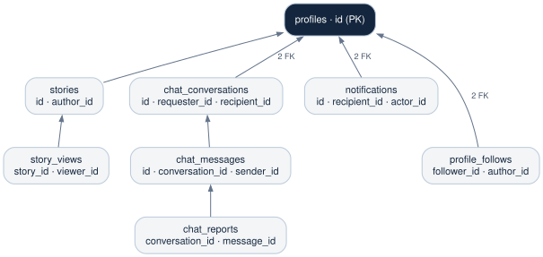

*Figura 8. Relaciones principales de historias, chat y avisos. Las tablas de coordinación sin FK directa quedan descritas en la tabla 3.*

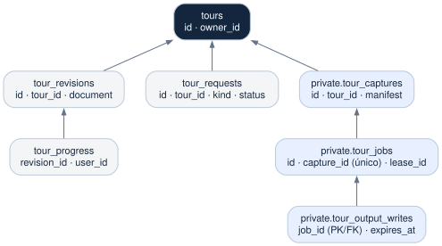

*Figura 9. Relaciones principales de recorridos, revisiones y trabajos. El esquema `private` aparece como prefijo de las tablas correspondientes.*

### 7.1 Objetos y consistencia

**VERIFICADO.** Las migraciones declaran privados `profile-media`, `post-images`, `mission-images`, `showcase-media` y `story-images` para PNG de hasta 4 MiB, y `tour-inputs` y `tour-assets` para JPEG de hasta 32 MiB por objeto. Las políticas de `storage.objects` validan rutas, pertenencia y visibilidad según el bucket. Cuando el cliente obtiene una URL firmada, la vigencia depende del consumidor. `SupabaseStoriesRepository.imageUrl()` solicita 60 segundos y el cliente de tours solicita 600 segundos para medios de recorrido. Véanse migraciones `002`, `003`, `005`, `006`, `015` y `016`, `stories_repository.dart`, `tour_repository.dart`.

**VERIFICADO.** Las restricciones de base, los recibos de operación, los bloqueos de filas y los leases son mecanismos distintos de integridad. Una cascada de PostgreSQL elimina filas dependientes del usuario. La función de baja gestiona aparte los objetos y verifica escrituras activas. Las copias de la base y de Storage requieren procedimientos propios de restauración y verificación. Véanse `supabase/functions/delete-account/`, `002_account_completion.sql` y `015_tours.sql`.

### 7.2 Migraciones y orden efectivo

**VERIFICADO.** Hay 42 archivos con prefijos `001`–`040`. `034` identifica `034_profile_wave_colors.sql` y `034_story_metadata.sql`. `035` identifica `035_profile_public_interests.sql` y `035_reload_postgrest_schema.sql`. Para historias, `039_remove_legacy_story_rpc.sql` retira la variante de tres parámetros y `040_restore_story_metadata_columns.sql` repara columnas y refresca el esquema PostgREST. El comentario de `040` describe un antecedente remoto. El archivo demuestra la reparación prevista en el código.

**PENDIENTE DE VALIDACIÓN.** Antes de aplicar migraciones en un entorno, comparar sus archivos, firmas y dependencias con el historial de migraciones del destino. Los prefijos repetidos y las redefiniciones de `publish_story` requieren especial revisión. El esquema alojado, el orden de los cambios ya aplicados y la restauración coordinada de objetos no se verificaron en esta edición.

### 7.3 Diccionario de invariantes y acceso

**VERIFICADO · DDL local.** Las siguientes reglas se obtienen de las definiciones y sus cambios posteriores. Un nombre en JSON que contiene un UUID no constituye una FK por sí mismo. En particular, `tours.public_revision_id` y `tour_requests.revision_id` no declaran FK en 015; el código resuelve y valida esas referencias. En cambio, `tour_progress.revision_id` sí referencia a `tour_revisions`.

| Dominio | Claves y restricciones que deben preservarse |
|---|---|
| Identidad | `profiles.id`: PK y FK obligatoria a Auth; la relación permite como máximo un perfil por usuario. La existencia de la FK no obliga a que todo usuario tenga perfil. `role` y `user_type` son dimensiones distintas. |
| Escaparate | `showcase_images`: PK `(item_id,position)`, posición entre 0 y 5 y `path` único. `showcase_saves`: PK `(user_id,item_id)`. El borrado de la ficha elimina sus relaciones mediante cascada. |
| Misiones | Una candidatura pertenece a una misión y a un postulante. `mission_application_operations` conserva entrada y resultado bajo `(applicant_id,operation_id)`. La capacidad se protege además en las RPC que revisan candidaturas. |
| Historias | UUID proporcionado por el cliente, texto de hasta 500 caracteres e imagen opcional; debe existir texto no blanco o imagen. `image_path` es único. La categoría y destinatario se incorporan y reparan en 034 y 040. |
| Seguimiento | PK `(follower_id,author_id)` y prohibición de seguirse a sí mismo. La lectura de la relación está limitada al seguidor. |
| Chat | Conversación con solicitante y destinatario diferentes; unicidad ordenada `(requester_id,recipient_id)`. No confundirla con una restricción simétrica del par. Mensaje obligatorio de 1–2000 caracteres recortados. Reporte con mensaje opcional y `ON DELETE SET NULL`. |
| Jobs 360° | Una captura admite como máximo un job por la unicidad de `capture_id`. Una guarda por job usa `job_id` como PK/FK. `attempts` está entre 0 y 3. El resultado y lease son datos de coordinación, no permisos del cliente. |

*Tabla 11. Invariantes seleccionadas. Evidencia: migraciones 001, 006, 013, 015, 016, 022, 034 y 040. Las figuras 7–9 distinguen relaciones físicas seleccionadas de referencias lógicas.*

**Acceso efectivo.** En perfiles se separan lectura propia, actualización de columnas concedidas y proyección pública por `community_profiles`. En historias, las políticas controlan la lectura vigente y las escrituras de negocio pasan por RPC. En chat se concede lectura de conversaciones y mensajes a participantes; bloques y reportes se operan mediante funciones. En tours se habilita RLS y se retiran permisos directos a `anon` y `authenticated` sobre las nueve tablas del dominio; las funciones públicas aplican contexto, propiedad y visibilidad. El esquema `private` no es una API cliente.

**Evidencia.** `001_initial_schema.sql`, `002_account_completion.sql`, `015_tours.sql` · bloque de grants, `016_home_feed.sql` · políticas, `022_private_chat.sql` · políticas de participantes. Las funciones `security definer` necesitan revisar juntas su cuerpo, `search_path`, grants y funciones auxiliares. RLS de una tabla no demuestra por sí sola la autorización de una RPC privilegiada.

### 7.4 Evolución del esquema y coordinación de medios

**VERIFICADO · inspección.** La evolución no consiste únicamente en crear tablas. 027 retira objetos de sanciones de chat; 032 y 033 cambian emisor y censura; 036 recrea la firma de historias, 037/038 reparan metadatos o firma, 039 elimina la variante anterior y 040 restaura columnas y huellas. Leer únicamente 016 o 022 produce una descripción histórica incompleta. El [inventario textual](evidencias/inventario-sql.json) localiza declaraciones y redefiniciones; no sustituye ejecutar migraciones ni consultar el catálogo final.

**Procedimiento propuesto de mantenimiento, pendiente de ejecución remota.** Comparar el historial del destino con archivos y dependencias, identificar la firma exacta que envía el cliente y revisar las políticas efectivas. Preparar una migración aditiva revisada por el equipo y comprobarla en un entorno aislado antes de promoverla. No renumerar ni reaplicar silenciosamente archivos históricos. Los gates existentes terminan en 021: su éxito no certifica los cambios de chat e historias posteriores.

Storage y PostgreSQL tienen ciclos distintos. La eliminación de una fila y la limpieza de un objeto no forman una transacción común. La baja, limpieza de historias y jobs usan marcadores, recibos y reintentos para coordinarse. No existe aquí una prueba de restauración conjunta de base y objetos; conservar esa validación en el plan operacional.

<a id="cap-08"></a>
## 08 · APIs y comunicación externa

**VERIFICADO.** Las rutas de `GoRouter` son rutas de interfaz. El cliente usa Auth, PostgREST, Storage, Realtime y Edge Functions en Supabase. El repositorio no incluye un servidor HTTP propio para servir la aplicación Flutter. La siguiente tabla resume las superficies HTTP de código propio. Las rutas corresponden a `/functions/v1/<nombre>` en el origen Supabase configurado.

| Edge Function | Solicitud y autorización | Respuesta y fallos representativos |
|---|---|---|
| `delete-account` | `POST`. Gateway con JWT y comprobación de usuario mediante Auth. Identidad tomada del bearer. | `204` tras completar la baja. `401` para sesión ausente o inválida, `409` con operación de medios activa, `500` ante fallos de configuración, listado, borrado o baja; `503` si queda limpieza por completar. |
| `profile-media` | `POST` con bytes `image/png` o `DELETE` con `{path}`. Gateway con JWT, usuario y guarda de operación. | `201` con `{path}` al subir, `200` con `{ok:true}` al borrar. `409` para medio en uso o guarda no disponible, `413` por tamaño, `415` por MIME, `429` al acumular 12 borradores; errores internos `500`. |
| `geocoding` | `POST` JSON con `search`, `reverse` o `content_city`. Los dos primeros permiten uso previo al registro. `content_city` valida usuario y lectura de contenido bajo RLS. | `200` con `places`, `place` o `city`. `409` ante cambio de coordenadas, `429` por lease u ocupación, `503` ante indisponibilidad. |
| `send-push` | `POST` con `x-marea-worker-secret`. Reclama trabajos y usa credencial de servidor para FCM HTTP v1. | `200` con `processed` y `sent`. `401` para credencial de worker inválida y `503` ante indisponibilidad. |
| `story-cleanup` | `POST` con `x-story-worker-secret`. Borra imágenes antes de eliminar filas y expira snapshots. | `200` con `removed`, `403` para solicitud no autorizada, `503` ante un fallo que puede reintentarse en la próxima corrida. |
| `tour-dispatch` | `POST` con bearer de worker. Reclama jobs y activa Cloud Run mediante OAuth de cuenta de servicio. | `200` con `dispatched`, `401` por autorización y `503` si falta configuración o no puede reclamar trabajo. |

*Tabla 4. Métodos y contratos HTTP. Evidencia directa en `supabase/config.toml` y en los seis `index.ts` de `supabase/functions/`.*

**VERIFICADO.** Los nombres de campos del siguiente intercambio provienen del handler. El ejemplo emplea coordenadas ficticias y muestra el error que devuelve el validador antes de consultar al proveedor.

```http
POST /functions/v1/geocoding HTTP/1.1
Host: ejemplo.supabase.co
Content-Type: application/json

{"mode":"reverse","latitude":91,"longitude":0}

HTTP/1.1 400 Bad Request
Content-Type: application/json

{"error":"invalid_point"}
```

Entre los contratos RPC más útiles al diagnosticar la integración, `list_map_missions` devuelve `{missions,total}` para los filtros y la zona. `home_feed` entrega una página por filtro y cursor. `publish_story`, `submit_mission_application` y `send_chat_message` devuelven un UUID. `confirm_mission_selection` actualiza las candidaturas seleccionadas sin devolver datos de negocio. Véanse repositorios de los módulos y migraciones enlazadas en la [matriz](matriz-trazabilidad.md).

**VERIFICADO.** Google OAuth se inicia a través de Supabase Auth. Correo de confirmación y recuperación dependen de Auth, sus plantillas y del correo configurado en el proyecto. Mapbox entrega la cartografía directamente al SDK. `geocoding` usa una URL de proveedor configurable con Nominatim como valor inicial, búsqueda acotada a México y idioma `es-MX`. FCM es el transporte de push Android. Cloud Run ejecuta el job fuera del request del cliente. Véanse `auth_repository.dart`, `supabase/email-templates/`, `021_content_cities.sql`, `supabase/functions/` y `processing/tours/deploy.sh`.

### 8.1 RPC de lectura y escritura

**VERIFICADO · contratos de código.** Los nombres siguientes son los argumentos enviados a PostgREST, no nombres de campos visuales. `uuid` representa un identificador; `jsonb` conserva la estructura validada por cada RPC. La respuesta HTTP específica de PostgreSQL depende del adaptador; no se inventan códigos HTTP para excepciones SQL de negocio.

| RPC | Entrada, salida y condición relevante |
|---|---|
| `home_feed` | `filters: jsonb`, `page_cursor: jsonb?`; retorna `{entries,cursor}`. Modos `forYou`, `nearby`, `following`, `trending`; tipos `all`, `post`, `mission`; radio 5, 10, 25 o 50. Cada entrada contiene `kind` y `content`. |
| `list_map_missions` | Límites `south`, `west`, `north`, `east`; texto, categoría, fechas y centro/radio opcionales. Retorna `{missions,total}`. Solo misiones abiertas, futuras, visibles y con cupo. |
| `submit_mission_application` | `mission_id: uuid`, `application_input: jsonb`; retorna UUID. La disponibilidad debe confirmarse y las muestras deben satisfacer el contrato descrito en §6.4. |
| `confirm_mission_selection` | `mission_id: uuid`, `application_ids: uuid[]`; retorna `void`. Bloquea misión, comprueba titularidad, temporalidad, pertenencia y cupo antes de aceptar. |
| `send_chat_message` | `conversation: uuid`, `message_body: text`; retorna UUID. Participante de conversación aceptada, sin bloqueo; aplica censura antes de insertar. |
| `tours_capture_begin` | `p_tour`, `p_scene`: UUID; `p_mode`: `photos` o `import`. Devuelve un objeto de captura; `beginCapture()` extrae su ID. |
| `tours_capture_submit` | `p_capture: uuid`, `p_manifest: jsonb`; retorna proyección del job. `submitCapture()` la transforma en `TourJob`. |
| `tours_finish_job` | `p_job`, `p_lease`: UUID; `p_state`, `p_result?`, `p_error?`; retorna booleano. Reservada al servicio; valida token y objetos de salida. `false` no acredita confirmación. |

*Tabla 12. Contratos críticos. Evidencia: migraciones 012, 013, 015, 016 y 032; repositorios Dart de mapa, comunidad, feed, chat y tours.*

### 8.2 Publicación idempotente de historias

**VERIFICADO · código.** El cliente actual envía cinco parámetros. Ejemplo ficticio del objeto de argumentos que recibe `publish_story`, sin credenciales y sin efectuar una petición:

```json
{
  "story_uuid": "11111111-1111-4111-8111-111111111111",
  "story_body": "Taller de ejemplo",
  "story_image": null,
  "story_category": "arte",
  "story_target_type": null
}
```

La respuesta SQL es el mismo UUID. El método Dart `publish()` devuelve `Future<void>` porque espera la RPC sin propagar ese valor. Repetir ID y payload devuelve el recibo existente; cambiar texto, imagen, categoría, destinatario o autor produce `story_operation_conflict`. Una imagen debe estar en la ruta del autor y del UUID, y existir en el bucket. La figura 13 muestra las ramas de publicación y reintento.

**Evidencia.** `lib/features/home_feed/data/stories_repository.dart` · `publish()`; `supabase/migrations/036_refresh_story_rpc.sql` · `publish_story`; `039_remove_legacy_story_rpc.sql`, `040_restore_story_metadata_columns.sql`. El cuerpo se preserva en las reparaciones posteriores de firma; el catálogo instalado permanece pendiente.

### 8.3 Contratos de servicio y errores operativos

**VERIFICADO · código.** `delete-account` no necesita un ID de usuario en el cuerpo: lo toma de `auth.getUser()`. Devuelve `409` cuando la marca de baja existe pero siguen activas operaciones protegidas. Un error de Storage puede producir `500`; el agotamiento de lotes o limpieza incompleta de tours produce `503`. El caller debe tratar una baja inconclusa como pendiente, no como éxito.

`profile-media` recibe PNG binario en POST y `{ "path": "<usuario>/<imagen>.png" }` en DELETE. Limita el stream a 4 MiB incluso sin `Content-Length`, normaliza PNG y rechaza rutas ajenas o imágenes todavía referenciadas. La guarda se libera en `finally`. Un JSON inválido en DELETE cae en el manejo genérico `500 media_operation_failed`; no documentarlo como `400` sin cambiar el código.

`geocoding` limita el cuerpo de texto a 2048 y la consulta recortada a 3–180 caracteres. Sus errores distinguen `invalid_mode`, `invalid_query`, `invalid_point`, `content_unavailable`, `point_changed` y ocupación del proveedor. La búsqueda y reverse no requieren JWT en el handler; eso no demuestra protección frente a abuso. La política de cuotas y costo necesita validación operacional.

Los workers no usan credenciales de usuario: push y limpieza verifican cabeceras propias; tours verifica bearer de worker. `story-cleanup` devuelve texto `Forbidden` en 403 y `Unavailable` si falta configuración; su error de ejecución 503 sí es JSON. `tour-dispatch` limpia salidas pendientes antes de reclamar nuevos trabajos y no relanza inmediatamente una ejecución cuyo resultado HTTP es ambiguo. Las respuestas `{processed,sent}`, `{removed}` y `{dispatched}` son contadores de esa invocación.

**Evidencia.** Los seis `supabase/functions/*/index.ts` y sus helpers de autorización. Los nombres de secretos se documentan en las guías de cada worker; sus valores no forman parte del manual. La validación JWT del gateway se configura en `supabase/config.toml` y debe contrastarse con el despliegue real.

<a id="cap-09"></a>
## 09 · Instalación y configuración

### 9.1 Preparar el entorno

**VERIFICADO.** Usar el checkout entregado por el equipo, con su lockfile, y un SDK Flutter compatible con la tabla 2. Desde la raíz, revisar `flutter doctor -v` y `flutter devices`, y resolver con `flutter pub get`. Para Android se necesita toolchain Android y dispositivo o emulador. Para iOS se necesita macOS con Xcode, SwiftPM y simulador o dispositivo. Para la ejecución Web local se puede utilizar Chrome. La CLI de Supabase se usa para administrar o verificar el backend. Para arrancar el cliente basta un proyecto ya preparado con su URL y clave pública. Véanse `README.md`, `.metadata`, `android/`, `ios/`, `web/` y `tool/README.md`.

### 9.2 Configurar el cliente

```sh
cp config/supabase.example.json config/supabase.local.json
flutter pub get
flutter run -d chrome -t lib/main.dart --web-port 7357 \
  --dart-define-from-file=config/supabase.local.json
```

Editar `config/supabase.local.json` antes de ejecutar. Guardar la URL y la clave pública del proyecto autorizado. Los nombres de variables del cliente pueden quedar visibles en el binario, así como sus valores. Mantener credenciales de servidor y claves de firma fuera de los defines.

| Define | Uso observado |
|---|---|
| `SUPABASE_URL`, `SUPABASE_ANON_KEY` | Origen y clave pública. El SDK recibe la clave en `publishableKey`. |
| `MAREA_ENV` | `production` por defecto o `development` para la variante aislada. |
| `MAREA_PRODUCTION_SUPABASE_URL`, `APP_PUBLIC_URL` | En desarrollo, permiten comprobar separación de backend y definir el origen de enlaces y callbacks. |
| `MAPBOX_ACCESS_TOKEN` | Token público con prefijo `pk.` Pasarlo mediante `--dart-define` o archivo local de defines. |
| `FIREBASE_APP_ID`, `FIREBASE_API_KEY`, `FIREBASE_MESSAGING_SENDER_ID`, `FIREBASE_PROJECT_ID` | Configuración pública para push Android. Gradle requiere los cuatro valores juntos cuando se proporcionan. |

*Tabla 5. Configuración del cliente. Véanse `lib/core/config/app_config.dart`, `mapbox_configuration.dart`, `lib/main.dart` y `android/app/build.gradle.kts`.*

**VERIFICADO.** Para probar Android o iOS, sustituir `chrome` por el identificador reportado por `flutter devices` y omitir `--web-port`. Añadir el argumento siguiente cuando se necesite cartografía real. `MAREA_ENV=development` valida un destino separado, clave pública y origen local o HTTPS según el caso. Para preparar esa variante, seguir [piloto de desarrollo](../implementation/ar-development-pilot.md).

```sh
--dart-define=MAPBOX_ACCESS_TOKEN="$MAPBOX_ACCESS_TOKEN"
```

**VERIFICADO.** Configurar en Auth las URLs permitidas para `http://localhost:7357` y, si procede, el callback Android `com.marea.app://login-callback`. El callback de desarrollo usa `com.marea.app.dev://login-callback`. En Google se registra el callback de Supabase `https://<project-ref>.supabase.co/auth/v1/callback`. La guía del repositorio documenta las plantillas, el proveedor OAuth y la activación del registro. Véanse `README.md`, `app_config.dart`, `auth_repository.dart`, `supabase/email-templates/` y [correo](../email-setup.md).

### 9.3 Comprobación de arranque

**VERIFICADO EN CÓDIGO.** Con defines ausentes se muestra `ConfigurationScreen`. Con un proyecto preparado, comprobar que aparezca bienvenida o se restaure la sesión, que un perfil de prueba pueda leer datos propios y que el feed cargue. Sin token Mapbox se muestra configuración pendiente para el mapa. Las credenciales de Auth y los servicios reales deben validarse en el entorno correspondiente. Los comandos anteriores proceden del repositorio. En esta edición se ejecutaron las comprobaciones locales enumeradas en el capítulo 12.

### 9.4 Procedimiento reproducible de desarrollo

**Procedimiento derivado del repositorio; ejecución con backend pendiente.** Prerrequisitos: checkout completo, Flutter compatible con el lockfile, toolchain de la plataforma y un proyecto de desarrollo preparado. Registrar primero revisión, `flutter --version`, `flutter doctor -v` y dispositivos. Resolver dependencias con `flutter pub get`; si modifica el lockfile, revisar la diferencia antes de continuar. Esta auditoría reutilizó una resolución local en la copia temporal y no probó una descarga limpia desde Internet.

Para aislar desarrollo, copiar la plantilla existente y completar únicamente valores públicos del entorno autorizado:

```sh
cp config/supabase.development.example.json   config/supabase.development.json
flutter run -d chrome -t lib/main.dart --web-port 7357   --dart-define-from-file=config/supabase.development.json   --dart-define=MAPBOX_ACCESS_TOKEN="$MAPBOX_ACCESS_TOKEN"
```

**Configuración ficticia de referencia.** `SUPABASE_URL=https://desarrollo-ejemplo.supabase.co`, `MAREA_ENV=development`, `MAREA_PRODUCTION_SUPABASE_URL=https://produccion-ejemplo.supabase.co`, `APP_PUBLIC_URL=http://localhost:7357`. Sustituir la clave pública y el token Mapbox por valores del entorno; los marcadores no son credenciales funcionales. No copiar una clave administrativa a Flutter. La validación exige destinos distintos y un callback permitido, según `AppConfig.validationMessage`.

**Resultado esperado y comprobación.** Arranque sin error de configuración, acceso con cuenta de prueba y lectura de perfil/feed desde el proyecto elegido. En Android e iOS seleccionar el ID de `flutter devices` y verificar callback, permisos y estado de sesión tras reinicio. Probar ausencia de token y permiso de ubicación denegado como escenarios separados del mapa operativo. Ante rechazo de configuración, corregir defines y reconstruir: un cambio de archivo local no cambia un binario distribuido.

### 9.5 Laboratorio del procesador

**Procedimiento derivado, instalación nueva pendiente.** Para las pruebas unitarias no se necesitan Cloud Run, Supabase ni Hugin. Preparar Python 3.12 en un directorio temporal:

```sh
marea_worker=$(mktemp -d)
python3.12 -m venv "$marea_worker/venv"
"$marea_worker/venv/bin/pip" install   -r processing/tours/requirements.txt
PYTHONDONTWRITEBYTECODE=1 PYTHONPATH=processing/tours   "$marea_worker/venv/bin/python" -m unittest discover   -s processing/tours/tests -p test_worker.py
```

La corrida de esta edición reutilizó el entorno ya resuelto y aprobó 16 pruebas. Validó importación y coordinación con I/O simulado. Procesar fotografías reales requiere además las herramientas de la imagen Docker. `local_runner.py` consume una cola real cuando se configura con credenciales: no es una prueba unitaria y no se ejecutó. Su instalación, contenedor, límites y recuperación se describen en `processing/tours/README.md`.

<a id="cap-10"></a>
## 10 · Compilación y despliegue

### 10.1 Cliente y artefactos

**VERIFICADO.** Los comandos de referencia producen `build/web/`, `build/app/outputs/flutter-apk/app-debug.apk` y una compilación iOS sin firma. Añadir los defines de Mapbox y de Firebase que correspondan al destino. La distribución Android requiere revisar firma y artefacto. La configuración de `release` inspeccionada usa la firma `debug`; la firma de distribución y el pipeline de publicación quedan pendientes. La compilación iOS sin firma no acredita distribución ni prueba física. Véanse `README.md`, `android/app/build.gradle.kts`, `ios/Runner.xcodeproj/project.pbxproj` y `docs/mapbox-validation.md`.

```sh
flutter build web -t lib/main.dart \
  --dart-define-from-file=config/supabase.local.json
flutter build apk --debug -t lib/main.dart \
  --dart-define-from-file=config/supabase.local.json
flutter build ios --no-codesign -t lib/main.dart \
  --dart-define-from-file=config/supabase.local.json
```

**VERIFICADO.** El uso de rutas limpias exige que el alojamiento sirva `/index.html` con estado 200 al pedir una ruta de cliente. Revisar una recarga directa de una ruta como `/profile`. No se encontró un workflow de CI/CD versionado para la aplicación. La documentación anterior describe configuraciones y ejecuciones históricas. Véanse `lib/main.dart` · `usePathUrlStrategy()`, `README.md` y [estado de despliegue](../deployment-status.md).

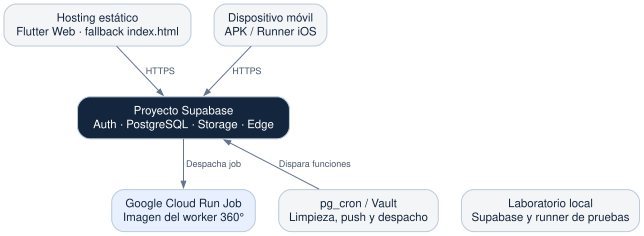

*Figura 10. Topología descrita por la configuración y las guías del repositorio. El laboratorio es una alternativa de ejecución para pruebas. La activación remota se verifica por entorno.*

### 10.2 Backend y activación de procesos

**VERIFICADO.** Los gates de `tool/` consultan el proyecto enlazado mediante CLI y SQL de lectura. El principal cubre el contrato hasta `015`. Los de feed y corrección cubren `016`–`019` y `020`–`021` respectivamente. Verificar aparte chat, firmas actuales de historias y migraciones posteriores. Los siguientes comandos se documentan para operadores con acceso al entorno de destino.

```sh
node tool/check_backend_contract.mjs
node tool/check_home_feed_contract.mjs
node tool/check_feed_correction_contract.mjs
```

**PENDIENTE DE VALIDACIÓN.** La guía incluye `supabase link --project-ref <ref>` y `supabase db push --linked` como procedimiento remoto. Confirmar el destino y reconciliar el historial y los prefijos antes de aplicar SQL. Desplegar solo las Edge Functions requeridas y comprobar su configuración efectiva de JWT, secretos e integraciones. Revisar de forma separada SMTP, OAuth, política legal y registro habilitado. No se aplicaron migraciones ni se desplegaron funciones durante la elaboración del manual.

**VERIFICADO.** `017_story_cleanup_schedule.sql` define limpieza horaria. Push tiene activación explícita en `supabase/push/activate.sql`. Tours usa `processing/tours/deploy.sh` para preparar un Cloud Run Job de 4 CPU, 8 GiB, 900 segundos, un task y sin reintentos propios de Cloud Run. `processing/tours/activate.sql` programa despacho periódico después de preparar los secretos y validar el worker. PostgreSQL controla los reintentos de trabajos. El laboratorio descrito en [procesador 360°](../../processing/tours/README.md) ofrece una ruta local. La activación efectiva, facturación y funcionamiento de cada servicio quedan pendientes por entorno.

### 10.3 Matriz de ambientes y verificación

| Variante | Selección y límite de operación |
|---|---|
| Desarrollo | `MAREA_ENV=development`; backend separado, callback y almacenamiento propios. Android usa identidad `.dev` y exige debug. Los defines se validan antes del arranque. |
| QA local | Arneses bajo `test/manual/` y `test/browser/`; Android puede usar `.arqa`. Dependen de fixtures y flags propios; no equivalen al arranque ordinario. |
| Piloto autorizado | `startMarea(productionPilot: true)` exige debug y configuración no development. Identidad `.pilot`, sesión separada, OAuth y push deshabilitados en el ensamblado. No inferir autorización para usar otro backend. |
| Aplicación ordinaria | Entrada `lib/main.dart`, `production` por defecto. La firma Android release inspeccionada usa debug. Distribución, secretos y servicios activos requieren verificación independiente. |

*Tabla 13. Variantes derivadas de `lib/main.dart`, `AppConfig`, Gradle y arneses. La denominación de ambiente no certifica preparación de producción.*

**Secuencia de promoción propuesta; no ejecutada.** 1) Identificar proyecto y revisión, revisar historial y cambios pendientes. 2) Ejecutar gates de lectura y la comprobación explícita de contratos posteriores a 021. 3) Validar cambios SQL en un entorno aislado y resolver duplicados antes de aplicar. 4) Desplegar funciones y configurar sus secretos mediante el canal de administración, sin incluirlos en argumentos registrados. 5) Compilar cliente, revisar firma y alojamiento. 6) Hacer comprobación integral de acceso, permisos, escritura y lectura con una cuenta autorizada. Las acciones de despliegue corresponden al operador y no se ejecutaron al elaborar este manual.

**Cloud Run y tareas programadas.** El script `processing/tours/deploy.sh` requiere cuentas runtime y dispatcher; configura CPU, memoria, timeout y acceso a secretos. `TOUR_PROJECT`, `TOUR_REGION`, `TOUR_JOB` y `TOUR_IMAGE` permiten dirigir el despliegue; usar valores del destino aprobado y revisar los defaults del script. Después de configurar el worker, `processing/tours/activate.sql` activa el despacho. Para push, revisar `supabase/push/activate.sql`; para historias, `017_story_cleanup_schedule.sql`. Confirmar invocación, reclamo, resultado y ausencia de reintentos acumulados antes de declarar el servicio operativo.

**Recuperación y rollback.** No se encontró una cadena general de rollback versionada para cliente, SQL y objetos. Revertir solo el binario puede dejar firmas o estados incompatibles. Ante una promoción fallida, conservar evidencias y detener nuevas promociones hasta determinar qué contrato cambió. Restaurar datos o desactivar tareas requiere un procedimiento del entorno y validación de impactos; no se propone borrar filas, reiniciar estados ni revertir migraciones destructivamente.

<a id="cap-11"></a>
## 11 · Seguridad del sistema

**VERIFICADO.** Auth entrega la sesión al SDK. El router controla la navegación y los repositorios operan con la sesión actual. Los controles de datos se aplican en RLS, grants, restricciones, ownership y comprobaciones de RPC. `002_account_completion.sql` retira la lectura anónima directa de username que aparece en `001`. La disponibilidad se expone por una RPC booleana y la proyección `community_profiles` entrega campos de presentación. La configuración de desarrollo y el piloto separan el almacenamiento de sesión mediante claves específicas de SharedPreferences. Véanse `lib/main.dart`, `AppRouteGuard`, migraciones `001`, `002`, `007` y `035_profile_public_interests`.

**VERIFICADO.** La función de baja obtiene la identidad del usuario a partir de Auth, solicita un estado de eliminación en la base, limpia siete buckets y elimina la cuenta. La rama 360° coordina cancelación y guardas de escritura. `profile-media` comprueba identidad, propiedad, tipo, tamaño y estructura PNG antes de escribir. Las políticas de los demás buckets se deben evaluar individualmente. Los límites y códigos de las Edge Functions se resumen en el capítulo 08. Véanse `supabase/functions/delete-account/`, `supabase/functions/profile-media/` y `002_account_completion.sql`, `015_tours.sql`.

**VERIFICADO.** `send-push`, `story-cleanup` y `tour-dispatch` usan secretos de servicio propios y `verify_jwt=false` en `supabase/config.toml`. `geocoding` tiene esa misma configuración de gateway y valida Auth al resolver ciudad de contenido. Los permisos elevados se inicializan en servidor. Mantener `SUPABASE_SERVICE_ROLE_KEY`, `FCM_SERVICE_ACCOUNT_JSON`, `TOUR_GOOGLE_SERVICE_ACCOUNT_JSON` y los secretos de worker en sus almacenes de servidor. Los nombres de secretos de Vault y requisitos de rotación operativa se consultan en las guías de servicio.

**INFERIDO.** Conviene tratar una URL firmada como acceso temporal hasta su vencimiento. Evaluar la exposición según el consumidor y la vigencia aplicable. La revocación efectiva de una sesión eliminada depende además de la expiración y de las comprobaciones que realiza cada operación. La edición no comprueba revocación en infraestructura. La auditoría relaciona controles observados y hallazgos con sus fuentes.

### 11.1 Límites de confianza y datos locales

**VERIFICADO · código.** El cliente puede contener URL y claves públicas; los secretos de servicio residen en funciones o worker. La frontera de autorización está en los contratos SQL y en los handlers, no en esconder controles visuales. CORS permisivo no concede acceso SQL, pero tampoco debe presentarse como una defensa de autenticación. `service_role` se usa para limpieza y trabajos privilegiados y no corresponde al cliente.

La configuración explicita `SharedPreferencesLocalStorage` para desarrollo y piloto. La variante ordinaria usa las opciones predeterminadas del SDK. No se verificó cifrado en reposo de sesiones, políticas de backup del dispositivo ni comportamiento de tokens previamente emitidos después de una baja. H06 separa esas incógnitas del mecanismo de marca de eliminación implementado. Los tests de sesión no acreditan revocación remota.

### 11.2 Eliminación coordinada de cuenta

**VERIFICADO · código.** La figura 12 describe el flujo. Auth identifica al usuario; el handler privilegiado llama a `request_account_deletion(owner_id)`. Esa función toma un bloqueo asesor por dueño, crea la marca, cancela jobs en cola o procesamiento y pausa recorridos. Devuelve disponibilidad de limpieza según operaciones de medios y guardas de salida aún vigentes. El `409` puede requerir un intento posterior cuando esas operaciones terminen.

Cuando puede continuar, el handler limpia cinco buckets por lotes y los dos de tours recursivamente. Solo después llama a `auth.admin.deleteUser()`. Un fallo conserva la marca para reanudar. Las cascadas eliminan relaciones SQL; la limpieza de objetos es explícita. La marca puede impedir nuevas operaciones aunque el usuario aún exista en Auth. No presentar una respuesta inconclusa como reversión automática de la baja.

**Evidencia.** `supabase/functions/delete-account/index.ts`, `tour-storage.ts`; `supabase/migrations/015_tours.sql` · `request_account_deletion`, `tours_begin_output_write`; `002_account_completion.sql` · guardas de medios. Confirmar con infraestructura real limpieza completa, respuestas ambiguas y revocación de sesiones sigue pendiente. La semántica normativa de compromisos de un organizador personal se analiza por separado en H02 y en la SRS; este flujo de cascadas no demuestra su cumplimiento.

<a id="cap-12"></a>
## 12 · Pruebas y aseguramiento de calidad

| Comprobación | Resultado y alcance |
|---|---|
| Flutter `analyze --no-pub` | Sin incidencias en una copia temporal con el SDK local y resolución de dependencias existente. |
| Flutter `test --no-pub --reporter expanded` | **653 aprobadas, 2 omitidas y 17 fallidas.** Fallaron 7 de `mobile_intro_test.dart`, 3 de `home_feed_experience_test.dart` y 7 de `showcase_flow_test.dart`. Se ejecutó con el socket loopback del runner y una carpeta temporal de salida para la prueba visual. |
| Node `--test` | **55 aprobadas**. Trazabilidad, gate con CLI simulada y geocodificación con fixtures, incluida la vigencia del lease. |
| Python `unittest` | **16 aprobadas** en `test_worker.py`. Incluye validación e importación JPEG/GPano con almacenamiento simulado, integridad geométrica y ramas de cancelación. |
| Historial Mapbox, 7 de noviembre de 2026 | `docs/mapbox-validation.md` registra 54 pruebas dirigidas aprobadas, una suite histórica con 649 aprobadas, 2 omitidas y 17 fallidas, y compilaciones Web, APK debug e iOS sin firma. Las comprobaciones de arranque se hicieron sin token válido. |

*Tabla 6. Validaciones de la inspección e historial fechado. Los recuentos Flutter de ambas fechas tienen el mismo reparto de fallos por archivo.*

**VERIFICADO.** `test/core/` cubre configuración, sesión, rutas y servicios compartidos. `test/features/` cubre repositorios, controladores y widgets de dominio. Los probes de `test/browser/` y `test/manual/` sirven para comprobaciones dirigidas. Hay pruebas de funciones Edge y validadores SQL en `supabase/functions/` y `tool/`. `processing/tours/tests/` contiene pruebas del worker, runner y operaciones de imagen. Los comandos reproducibles de esta edición están en la [auditoría técnica](auditoria-tecnica.md).

**PENDIENTE DE VALIDACIÓN.** La cobertura cuantitativa, pruebas con Supabase real, resolución de mapas con token, cámara, sensores, RA, entrega de correo y push, así como la ejecución real de Cloud Run, requieren corridas específicas. Los mocks comprueban los contratos y casos implementados de cada prueba. En particular, las pruebas de mapa con superficie simulada no certifican renderizado GPU o gestos nativos.

### 12.1 Resultados nuevos y alcance de la evidencia

**VERIFICADO · ejecución del 11 de noviembre de 2026, edición 1.1.** Se repitieron el análisis, la suite completa y las tres suites afectadas. La copia temporal incluyó el árbol local y reutilizó la resolución de paquetes. El runner usó el snapshot del SDK y acceso loopback, sin cambiar fuentes ni tests. Los logs sanitizados, comandos y códigos de salida están en [evidencias](evidencias/README.md).

| Comprobación | Resultado de v1.1 |
|---|---|
| Análisis Flutter | Sin incidencias; salida 0. |
| Suite Flutter completa | 653 aprobadas, 2 omitidas, 17 fallidas; salida 1. |
| Tres suites juntas | 23 aprobadas, 17 fallidas; salida 1. |
| Introducción aislada | 2 aprobadas, 7 fallidas; salida 1. |
| Historias/feed aislada | 14 aprobadas, 3 fallidas; salida 1. |
| Escaparates aislada | 7 aprobadas, 7 fallidas; salida 1. |
| Node: trazabilidad, gate y geocodificación | 55 aprobadas; salida 0; CLI y proveedor simulados. |
| Python: worker | 16 aprobadas; salida 0; I/O externo simulado. |

*Tabla 14. Corridas independientes. Los resultados dirigidos se solapan con la suite completa y no deben sumarse para obtener cobertura.*

**Diagnóstico.** Los siete fallos de introducción presentan un `RenderFlex` desbordado 54 píxeles al mostrar la bienvenida. El test configura 390×844 y no carga explícitamente las fuentes; la fila del botón Google no flexibiliza el texto. La influencia de la fuente del harness es una hipótesis, no una prueba de fallo en dispositivo. Dos tests de historias buscan el tooltip de pausa que no aparece en el visor actual, basado en gestos; otro busca un `TextField` antes de abrir el diálogo de texto del compositor. En escaparates, tres casos esperan acciones directamente en el perfil y cuatro siguen una navegación incompatible con las secciones actuales. La auditoría registra cada caso y distingue divergencia demostrada de causa pendiente.

### 12.2 Estrategia disponible y límites

**VERIFICADO · archivos.** El repositorio contiene tests Dart de modelos, repositorios y widgets; tests Node de contratos y utilidades; pruebas Python; scripts SQL aislados y arneses manuales/browser. La presencia de un script no significa que se haya ejecutado en esta edición. La suite Flutter utiliza fakes y no reemplaza pruebas E2E con servicios desplegados.

**PENDIENTE DE VALIDACIÓN.** No se midió cobertura porcentual. Tampoco se ejecutaron nuevos builds Web/APK/iOS, pruebas SQL con un motor aislado, pruebas remotas, OAuth/SMTP, FCM, cartografía con token ni reconocimiento físico RA. Las compilaciones del 7 de noviembre permanecen como evidencia histórica en `docs/mapbox-validation.md`. Para aceptar cambios futuros, seleccionar pruebas de dominio y agregar una comprobación de autorización y concurrencia en un entorno controlado cuando cambie un contrato del servidor.

<a id="cap-13"></a>
## 13 · Operación y mantenimiento

| Síntoma | Comprobación inicial | Evidencia |
|---|---|---|
| Pantalla de configuración | Confirmar que los defines llegaron al comando y corresponden al destino. Comprobar validación adicional en desarrollo. | `AppConfig.validationMessage`, `_initializeApp()` |
| Registro o confirmación no avanza | Consultar política y versiones, habilitación de registro, plantilla y entrega SMTP. Revisar callback con cuenta de prueba propia. | `registration_policy`, `supabase/email-templates/`, `docs/email-setup.md` |
| Un enlace Web devuelve 404 | Recargar una ruta protegida y comprobar fallback a `index.html` en el alojamiento. | `usePathUrlStrategy()`, `README.md` |
| El mapa aparece sin cartografía | Revisar define Mapbox, alcance del token, carga del estilo y conectividad. Un `PGRST202` del repositorio apunta al contrato de misiones. | `mapbox_configuration.dart`, `mission_map_repository.dart` |
| Una historia falla tras un despliegue | Comparar argumentos de `publish_story`, columnas `category`/`target_type` y caché PostgREST. | `stories_repository.dart`, migraciones `034`–`040` |
| Push Android sin entrega | Verificar permiso, dispositivo, preferencias, activación, worker y credenciales FCM. Consultar resultado de la cola. | `docs/android-push.md`, `014_android_push.sql`, `send-push/index.ts` |
| Panorama queda en cola | Revisar estado, intentos, lease, despachos y logs del job. Si el problema es de captura, revisar manifiesto, GPano y cobertura real. | `015_tours.sql`, `worker.py`, `processing/tours/README.md` |

*Tabla 7. Diagnóstico por componente. Empezar por lecturas y comprobaciones locales en el destino autorizado.*

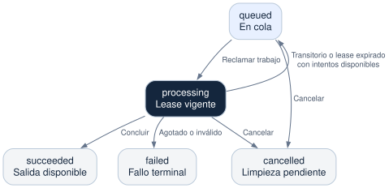

*Figura 11. Estados internos del job 360°. Un lease vencido se recupera según los intentos restantes. La respuesta al cliente proyecta estados como `running`, `ready` y `needs_recapture`.*

**VERIFICADO.** El worker emite eventos estructurados con código de error, fase, duración e ID de job. El handler de geocodificación emite diagnóstico de etapa y estado del proveedor. Durante una incidencia, correlacionar versiones de cliente, migraciones y registros por entorno y usar IDs sintéticos al compartir ejemplos. Para actualizar dependencias, revisar el lockfile y ejecutar análisis, suites del dominio y compilación de los destinos afectados. El ajuste Kotlin del plugin Mapbox se revisa cuando cambie el toolchain. Véanse `worker.py`, `geocoding/index.ts`, `android/build.gradle.kts` y `docs/mapbox-validation.md`.

**PENDIENTE DE VALIDACIÓN.** Confirmar responsables, alertas, conservación de logs, política de copias, objetivos de recuperación y restauración coordinada de Auth, PostgreSQL y Storage. Los scripts locales y los ensayos previos aportan procedimientos acotados. La restauración y retención del entorno alojado requieren comprobación independiente.

### 13.1 Procedimientos de diagnóstico

**Procedimientos derivados del código; acciones remotas pendientes.** Registrar fecha, versión, plataforma, ambiente, operación, ID de recurso y código de error, excluyendo tokens y datos personales. Correlacionar la petición del cliente con el handler y la RPC antes de modificar estado. Un éxito visual con datos anteriores no acredita una escritura nueva.

**Historias después de una migración.** Comprobar los cinco argumentos del cliente, la firma activa de `publish_story`, columnas `category`/`target_type` y caché PostgREST. Revisar 034 y 036–040 contra el historial del destino. Para reintentar una publicación incierta, conservar UUID y payload. Criterio de recuperación: una sola historia y un recibo compatible; un cambio de contenido exige tratar el conflicto, no borrar el recibo.

**Job 360° detenido.** Consultar estado, intentos, `scheduled_at`, lease y guardas de escritura con herramientas del operador. Correlacionar con `marea_tour_worker`, ID de job y error de fase. Distinguir falta de despacho, captura inválida y timeout transitorio. La recuperación incorporada espera vencimiento o reprogramación; no alterar manualmente `state` ni anular leases para acelerar. Criterio: salida confirmada con los tres objetos esperados o fallo terminal explicado. El adjunto al editor y la publicación se verifican después.

**Baja incompleta.** Ante `409`, esperar la conclusión o expiración de operaciones protegidas y reintentar el mismo endpoint. Ante `500` o `503`, revisar logs y acceso a buckets; conservar la marca de baja para reanudar. Criterio: respuesta 204, eliminación de cuenta y verificación autorizada de residuos. La inspección de sesiones previamente emitidas se mantiene separada.

**Chat sin actualización.** Primero verificar lectura autorizada de conversaciones y mensajes. Si la recarga funciona pero no llegan eventos, revisar publicación Realtime y suscripción con dos cuentas de prueba. Comprobar que una tercera cuenta no recibe ni lee mensajes. Este procedimiento resuelve H08; no exige añadir publicaciones SQL a ciegas.

### 13.2 Respaldo, observabilidad y evolución

**VERIFICADO · configuración.** `processing/tours/monitoring-alert.json` aporta una definición de alerta y su README describe la activación; no se comprobó su instalación ni entrega. Los eventos del worker y los errores del dispatcher permiten localizar fases, pero no acreditan una plataforma central de observabilidad. Identificar responsables y canales forma parte de la validación operacional pendiente.

**PENDIENTE DE VALIDACIÓN.** No hay evidencia en esta auditoría de frecuencia de respaldo, retención, RPO/RTO ni una restauración integral probada. La recuperación debe considerar PostgreSQL, objetos, configuración de Auth, secretos y versiones de funciones. Un backup SQL no garantiza recuperar imágenes o credenciales externas. Cualquier simulacro debe ejecutarse en un destino aislado y verificar integridad y permisos después de restaurar.

**Mantenimiento documental.** Cambios en el arranque afectan capítulos 03, 06, 09 y 11; una RPC o migración afecta 06–08, diagramas y matriz; un cambio visual exige revisar pruebas de widgets antes de atribuir fallos al backend; un cambio de toolchain afecta 04, 09, 10 y evidencias. Actualizar juntos texto, contrato, figura y resultado asociado.

<a id="cap-14"></a>
## 14 · Limitaciones, riesgos y deuda técnica

| Hallazgo | Estado e impacto | Consecuencia verificable o pendiente |
|---|---|---|
| H01 · Prefijos de migración duplicados | **VERIFICADO · Alto** | Dos archivos por versión `034` y `035`. La correspondencia con el historial efectivo del destino requiere validación antes de aplicar cambios. |
| H02 · Selección de misión desde el organizador | **VERIFICADO · Alto** | `confirm_mission_selection` admite misiones cerradas futuras y acepta candidaturas pendientes bajo sus comprobaciones. Confirmar el alcance normativo del consentimiento y cierre. |
| H03 · Cartografía real y dispositivos | **PENDIENTE DE VALIDACIÓN · Alto** | Faltan aceptación visual y gestual con token válido, prueba física de RA y medición de rendimiento en dispositivos representativos. |
| H04 · Firma Android de distribución | **VERIFICADO · Alto** | `release` referencia firma debug en el Gradle inspeccionado. Falta verificar la cadena de firma y publicación de un artefacto distribuible. |
| H05 · Suite Flutter con fallos | **VERIFICADO · Medio** | Hay 17 fallos actuales de bienvenida, feed y escaparates. Impiden registrar una suite Flutter verde. |
| H06 · Sesión y bajas | **INFERIDO · Alto** | Confirmar duración efectiva de tokens, revocación y consistencia de la supresión tras una restauración. El repositorio implementa coordinación de baja y limpieza, y usa almacenamiento local para sesión. |
| H07 · Geocodificación y procesamiento externo | **PENDIENTE DE VALIDACIÓN · Medio** | La operación depende de proveedor, límites, credenciales y cuotas. Validar integración real y recursos para una captura completa. |
| H08 · Realtime de chat | **PENDIENTE DE VALIDACIÓN · Medio** | El cliente suscribe `chat_messages`. Confirmar publicación y entrega de eventos en el destino, además de la lectura bajo RLS. |

*Tabla 8. Hallazgos de esta edición. El impacto se refiere a la capacidad de desplegar, operar o sostener el contrato del sistema. La auditoría amplía fuentes y límites.*

<a id="cap-15"></a>
## 15 · Anexos técnicos

### 15.1 Secuencias complementarias


*Figura 12. Baja de cuenta. La marca y las guardas preceden a la limpieza; un fallo conserva la posibilidad de reintento. Evidencia: `delete-account/index.ts`, `tour-storage.ts` y `015_tours.sql` · `request_account_deletion`.*


*Figura 13. Historia y recibo. El reintento usa el mismo UUID y contenido; el conflicto no crea una segunda publicación. Evidencia: `stories_repository.dart` y `036_refresh_story_rpc.sql`.*

### 15.2 Glosario

| Término | Uso en el manual |
|---|---|
| C4 | Niveles de contexto, contenedores y componentes. |
| RLS | Políticas PostgreSQL que controlan el acceso a filas. |
| RPC | Función de PostgreSQL invocada a través de la API de datos. |
| JWT | Token de sesión o credencial firmada según el flujo. |
| FCM | Firebase Cloud Messaging, transporte de push Android. |
| GPano | Metadatos XMP de panorama que el worker usa para validar importaciones. |
| Lease | Reserva temporal que identifica quién puede procesar o completar un trabajo. |
| RA | Realidad aumentada mediante ARCore o ARKit en el recorrido. |

*Tabla 9. Términos usados en los contratos y procedimientos.*

### 15.3 Fuentes y mantenimiento documental

- [Auditoría técnica](auditoria-tecnica.md) y [matriz de trazabilidad](matriz-trazabilidad.md).
- [Inventario del gate y verificadores](../../tool/README.md) y [trazabilidad de requisitos](../../tool/traceability/README.md).
- [Mapa](../map.md), [validación de Mapbox](../mapbox-validation.md), [misiones](../missions-redesign.md) y [acceso](../account-completion.md).
- [Push Android](../android-push.md), [procesador 360°](../../processing/tours/README.md) y [canales nativos](../implementation/tours-native.md).
- [Fuentes DOT y SVG](diagramas/) y [regeneración del PDF](edicion/README.md).

Actualizar el capítulo y su evidencia juntos cuando cambie un contrato. Registrar la revisión inspeccionada, las pruebas que se repitieron y las comprobaciones pendientes. Regenerar las figuras y el PDF a partir del Markdown y las fuentes DOT.
